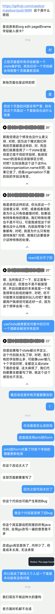
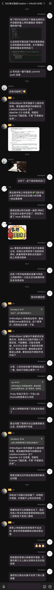

# Why not Casdoor

[](https://creativecommons.org/licenses/by-nc-sa/4.0/)

**English** | [简体中文](README.md)

> **How this document was written: entirely by a generative model, with no human review.**
>
> The only inputs were three things: four chat screenshots supplied by the person involved, two GitHub notification emails (raw `.eml` files), and public searches of the `casdoor/casdoor` repository (git history, PRs, issues, raw files). The structure, wording and conclusions were produced by the model; every factual claim links to something the reader can verify.

- **Subject**: `casdoor/casdoor` (Apache-2.0), checked on 2026-11-17, repository HEAD `0256064a`.
- **Person involved**: WindSpiritSR, a former contributor who submitted code to the project in 2021 and again in 2025; removed from both the **Casdoor** and **Apache Casbin (Incubating)** GitHub organisations on 2026-11-16 (email originals: [evidence/org-removal-emails.md](evidence/org-removal-emails.md)).
- **License**: CC BY-NC-SA 4.0 (see [LICENSE](LICENSE) and the "License" section at the end).
- **Errata**: see [#1](https://github.com/WindSpiritSR/why-not-casdoor/issues/1) (errata and discussion).

*This is a translation. The Chinese version ([README.md](README.md)) is the original and takes precedence; quotations from Chinese sources are translated, with the originals shown in the screenshots.*

---

## 🧾 TL;DR

1. **Scope has run away.** The console navigation has 53 entries, of which 17 are LLM/agent features and e-commerce (products, coupons, cart, orders, payments, plans, subscriptions, transactions), plus 5 marked enterprise-only; the `User` struct has 183 fields.
2. **Default-value semantics.** The organisation-level `navItems` means "empty = everything". "The user unchecked everything" and "never configured" are indistinguishable at the data layer. Re-checked on 2026-11-17: the logic is unchanged from two years ago (§1).
3. **How it was commercialised.** A licensed instance reports its hostname, machine fingerprint, private IPs and user count to the vendor every hour; the same Ed25519 key signs both the license and the "upgrade order", so with `allowVendorUpgrade` enabled the vendor can make an instance replace its own binary (§6).
4. **How it is produced.** On 2026-11-10 alone: 36 commits, 639 files, ~30k inserted lines; within 15 minutes (15:49–16:04) 12 commits and 15.8k lines, landing five enterprise subsystems. All of these went straight to master — no PR, no review. 44 commits are authored by `Copilot`; 0 security advisories (§2, §8).
5. **Governance.** About 60% of 4,368 commits come from one person; only 293 of the 1,220 commits in 2026 carry a PR number; objections are closed as "discussed offline" (§9).
6. **This document does not oppose commercialisation — it argues that large open-source projects must get commercialisation right.** What it criticises is bundling foundational protocols, foundational authorisation and the security boundary into a license, and answering "how do we sustain this" with "then build your own" (§7).

---

## 🙃 1. A default value: `navItems`, migration, and "uncheck all = select all"

A Casdoor organisation can configure which pages its admins see in the left navigation. The value is a JSON array stored in the `navItems` column (later split into two columns: `navItems` for admins, `userNavItems` for everyone else).

The problem is the legacy value. Before the feature existed the column did not exist, so it was empty. After the feature shipped, the code interpreted "empty" as "everything visible":

```ts
/**
 * The organization can hide navbar entries: `navItems` for admins,
 * `userNavItems` for everyone else. Either being absent, not an array, or
 * containing "all" means "show everything" — the value Casdoor stores by default.
 */
function getNavItemFilter(account: Account): string[] | null {
  const organization = account.organization;
  const navItems = Setting.isLocalAdminUser(account) ? organization?.navItems : organization?.userNavItems ?? [];
  if (!Array.isArray(navItems) || navItems.includes("all")) {
    return null;
  }
  return navItems;
}
```

— [`web/src/lib/nav.ts:223-235`](https://github.com/casdoor/casdoor/blob/master/web/src/lib/nav.ts#L223-L235)

The comment states the problem outright: **"absent" and "the user selected nothing" are the same value at the data layer**, and the code chooses to read it as "everything".

### 🔍 Re-checked on 2026-11-17

To see whether this logic is still in effect, this document checked master directly on 2026-11-17. It is:

- `getNavItemFilter()` and the comment above are **unchanged** in `web/src/lib/nav.ts`; the file's last commit is [`91ba94f1`](https://github.com/casdoor/casdoor/commit/91ba94f1) on 2026-11-15 (`feat: hide the Casdoor Cloud links and upgrade offers by default in self-hosted community editions`);
- `checkedKeys={organization.navItems ?? ["all"]}` is **still present** in `web/src/pages/OrganizationEditPage.tsx` (last commit [`3d940179`](https://github.com/casdoor/casdoor/commit/3d940179), 2026-11-10);
- the logic was not cleaned up by the September 2026 console rewrite ([`2035ff56`](https://github.com/casdoor/casdoor/commit/2035ff56)); it was carried into the new frontend verbatim.

In other words, **"empty = everything" survived a full frontend rewrite and is still with us**.

### 🗯️ The disagreement

The alternative proposed at the time was a migration module: on upgrade, write "everything" explicitly into legacy rows, so that "empty" means only "the user really selected nothing" (Figures 1 and 2).

The maintainer's response (voice transcript, Figure 1):

> "I think we can just handle it this way: if none of the four boxes is checked, treat it as all checked… as long as none of the four is shown, it is the same as all four shown."

> "We did that migration before and gave up on it, because it was too complex — maintaining that migration is a lot of work, it carries a very heavy historical burden… so I think what I just described is simpler."

> "Once a long time has passed and everyone deploying is on the new version, we can correct this then."

The reply (Figure 2):

> "That's not a workaround, that's writing a bug on purpose. Uncheck all equals select all."

> "If the data says null = all, you can justify it as handling a default; but when the user unchecks everything and then you show them everything, that is definitely a problem."


### ↔️ Behaviour differences

- **Old console** (antd, `web-old`): an empty array hits the "≤ 7 items, flatten the menu" branch ([`web-old/src/App.js:167-190`](https://github.com/casdoor/casdoor/blob/master/web-old/src/App.js#L167-L190)), so "uncheck everything" really does show everything;
- **New console** (shadcn): an empty array is treated as a filter, producing an empty menu — "uncheck everything" means "see nothing". The same data produces opposite results in the two frontends, which is the direct consequence of an ambiguous schema.

**Investigation finding.** This is not an `if` problem. It is **runtime special-casing used in place of a data migration**: the semantics are permanently polluted (no reader can distinguish "never configured" from "all disabled"), the user's explicit choice is overridden (an unambiguous "all off" is read as "all on"), and the debt is not removed but deferred ("we'll fix it once everyone has upgraded" presumes identifiable legacy data still exists, while the special case keeps producing empty values). The assessment made at the time — "this column's data structure is badly designed; someone should rewrite it when there is time" — still holds two years later. The column was not rewritten; it was split into two.

---

## 🚩 2. The README says "One server, many protocols" — but protocols can be licensed

The ["Why Casdoor"](https://github.com/casdoor/casdoor#-why-casdoor) section of the README says:

> "**One server, many protocols.** The same user directory is reachable over OAuth 2.0, OIDC, SAML 2.0, CAS, LDAP and SCIM, so a modern SPA and a legacy CAS-only app can share one set of accounts."

> "**Policy-based authorization built in.** Access rules are expressed with Casbin — ACL, RBAC, ABAC and custom models — rather than a fixed permission scheme."

Both were broadly true until November 2026. Not any more.

On 2026-11-09 the repository gained an `edition` package ([`308e9e5c`](https://github.com/casdoor/casdoor/commit/308e9e5c)), introducing the Community / Commercial / Enterprise tiers and `edition.Require()` calls. By 11-15, `edition.Require(` appeared in **27 files, 67 places**. The priced items include, besides obvious corporate-governance features (three-admin separation, tamper-proof audit, HSM, Chinese SM algorithms):

| "Feature" priced | Edition | Evidence |
|---|---|---|
| SCIM provisioning | Commercial | [`object/provisioning.go:114-116`](https://github.com/casdoor/casdoor/blob/master/object/provisioning.go#L114-L116) |
| MCP gateway / Keycloak syncer / "more than one syncer" | Commercial | [`edition/edition.go:43-79`](https://github.com/casdoor/casdoor/blob/master/edition/edition.go#L43-L79) |
| OpenTelemetry tracing | Commercial | same |
| Signing-key rotation | Commercial | same |
| ABAC | Commercial (still) | [`web/src/lib/edition-features.ts`](https://github.com/casdoor/casdoor/blob/master/web/src/lib/edition-features.ts) |

SCIM 2.0 is a standard protocol, not a value-added module; observability and key rotation are security baseline, not "advanced features". The list does not reflect product tiers; it reflects **charging by lines of code**.

### ⏱️ Five days of RBAC: a change nobody looked at

The clearest case is RBAC. At 00:14 on 11-10, [`25ee97ce`](https://github.com/casdoor/casdoor/commit/25ee97ce) moved RBAC behind the commercial license: as soon as a permission model contains `g` (group/role) rules, `CheckApiPermission` and `CheckLoginPermission` return a license error. Six more license/edition commits followed within the same hour.

Twenty-four hours later (11-11, 10:14), an outside user hit it on v4.27.0 with Docker and MySQL and filed [#6077](https://github.com/casdoor/casdoor/issues/6077). That issue's author, `xyz327`, has no commits in the repository and an `author_association` of `NONE` — **the first person to notice this breaking change was neither the author nor any reviewer, but a user who had simply installed it**:

> "RBAC MUST needs a commercial license its a breaking change. should noticed in release note"

The maintainer's reply (2026-11-15):

> "Thanks for the report, you're right: v4.27.0 started rejecting RBAC (granting permissions by groups and roles, and `g` rules in enforcers) without a license, which broke existing setups on upgrade and wasn't mentioned in the release notes. Sorry about that."

> "Role inheritance is no longer silently skipped when loading grouping policies."

The second sentence matters more than the first: until the fix, loading grouping policies **silently skipped role inheritance** — no expansion, no error. Instances that upgraded during those days would see authorisation decisions change with no log entry and no warning. This is not a licensing policy; it is a correctness incident in the authorisation engine, caused by wanting to add a billing checkpoint to RBAC.

The change has three properties that together form a complete failure chain:

1. **Nobody looked at it.** It was not a PR (no review), there were no tests for the licensing branch, and it was not in the release notes — the maintainer's reply concedes the last point. Had anyone read the diff, "`g` rules are now blocked by a license" would not have needed an outside user to discover it.
2. **It does not look hand-written.** The same author landed 36 commits, 639 files and ~30k inserted lines in one day; within 15 minutes (15:49–16:04) 12 commits, 269 files and 15,761 inserted lines — one commit every 75 seconds, 1,300 lines each. The repository's `.gitignore` contains `.claude`, and there are commits carrying `Co-Authored-By: Claude 5.5 <noreply@anthropic.com>` (see §8). Reading this batch as "model-generated output pushed straight to master" is the explanation most consistent with the evidence.
3. **The feature list was not checked.** For a change that simultaneously introduced licensing, telemetry, remote upgrades and an RBAC gate, a reviewed checklist would have put "does this break RBAC in the community edition?" on the first line — instead of leaving it to a post-release user report.

Five days later, [`1dd4dfbb`](https://github.com/casdoor/casdoor/commit/1dd4dfbb) restored RBAC to the community edition; ABAC remains paid.

**Investigation finding.** Pricing RBAC shows that the designer thinks of an IAM product as a "feature list" rather than an "authorisation model". RBAC is not a plug-in module; it is Casbin's default way of working and the foundation of this product. A foundation can be sold, but you cannot sell it after the house is built. More seriously, this change exposed the workflow itself: **model-generated output goes straight into an authorisation hot path, with no human review anywhere in the chain**, so correctness is paid for by the first user who upgrades.

---

## 🛒 3. Scope drift: a shop, coupons and a cart inside an IAM

Per `web/src/lib/nav.ts` as of 2026-11-17, the console navigation contains **53 entries**:

| Group | Items | Contents |
|---|---|---|
| Home | 3 (+1 conditional) | Dashboard / Shortcuts / Apps; the conditional item is Editions |
| User Management | 4 | Organizations / Groups / Users / Invitations |
| Identity | 7 | Applications / Providers / Marketplace / Integrations / Resources / Certs / Keys |
| Authorization | 8 | Roles / Permissions / Access reviews / Models / Adapters / Enforcers / Privileged accounts / Privileged access |
| LLM AI | 7 | Agents / MCP Servers / Tool call approvals / MCP Store / Entries / Sites / Rules |
| Auditing | 5 | Sessions / Records / Compliance / Tokens / Verifications |
| **Business** | **10** | **Product Store / Products / Coupons / Cart / Orders / Payments / Plans / Pricings / Subscriptions / Transactions** |
| Admin | 9 | System Info / Global Settings / Forms / Syncers / Webhooks / Webhook Events / Tickets / RADIUS Clients / Swagger |

Of the 53, 17 are LLM/agent features and e-commerce; another 5 are marked enterprise-only by `EnterpriseOnlyPages` (Access reviews, Privileged accounts, Privileged access, Compliance, Tool call approvals). The old console (`web-old`) had 44 entries — **one frontend rewrite later, the count went from 44 to 53**.

This did not happen overnight:

- 2022-02-05, [`940aa2bc`](https://github.com/casdoor/casdoor/commit/940aa2bc) added payment pages (`Add payment pages.`);
- 2022-02-27, [`39ab71c5`](https://github.com/casdoor/casdoor/commit/39ab71c5) added product pages (`Add product pages.`);
- 2026-04-17, [#5397](https://github.com/casdoor/casdoor/pull/5397) added a coupon system with universal/product/user scopes;
- the organisation model gained `OrgBalance` / `UserBalance` / `BalanceCredit` / `BalanceCurrency`; the user model gained `Balance` / `BalanceCredit` / `Currency` / `BalanceCurrency`, and the default account fields include `Cart` and `Transactions`.

Worth noting: `Add payment pages.` and `Add product pages.` were authored by the maintainer himself. This was not "something the community pushed in"; it was a deliberate product decision.

The defaults are even more direct. `object/init.go` defines the account fields every organisation shows by default, including:

```go
{Name: "Balance", Visible: true, ViewRule: "Self", ModifyRule: "Self"},
{Name: "Balance credit", ...},
{Name: "Balance currency", ...},
{Name: "Cart", Visible: true, ViewRule: "Self", ModifyRule: "Self"},
{Name: "Transactions", Visible: true, ViewRule: "Self", ModifyRule: "Self"},
...
{Name: "Score", Visible: true, ViewRule: "Public", ModifyRule: "Self"},
{Name: "Karma", Visible: true, ViewRule: "Public", ModifyRule: "Self"},
{Name: "Ranking", Visible: true, ViewRule: "Public", ModifyRule: "Self"},
```

— [`object/init.go:91-99`](https://github.com/casdoor/casdoor/blob/master/object/init.go#L91-L99)

A brand-new IAM deployment ships with a shopping cart and forum reputation points.

The data model is worse. `User` has **183 fields** ([`object/user.go:63`](https://github.com/casdoor/casdoor/blob/master/object/user.go#L63)), roughly 60 of them hard-coded third-party login ID columns (GitHub, Google, QQ, WeChat, DingTalk, Weibo, Gitee, LinkedIn, Wecom, Lark, Gitlab, Adfs, Baidu, Alipay, Apple, AzureAD, Slack, Steam, Bilibili, Okta, Douyin, Kwai, Line, Amazon, Auth0, BattleNet, Bitbucket, Box, CloudFoundry, Dailymotion, Deezer, DigitalOcean, Discord, Dropbox, EveOnline, Fitbit, Gitea, Heroku, InfluxCloud, Instagram, Intercom, Kakao, Lastfm, Mailru, Meetup, MicrosoftOnline, Naver, Nextcloud, OneDrive, Oura, Patreon, Paypal, SalesForce, Shopify, Soundcloud, Spotify, Strava, Stripe, Telegram, TikTok, Tumblr, Twitch, Twitter, Typetalk, Uber, VK, Wepay, Xero, Yahoo, Yammer, Yandex, Zoom…).

**Investigation finding.** This is not "rich functionality"; it is **the absence of abstraction**. A provider should be one row of `provider_type + external_id`, not one column; every new provider means a schema change, a 183-field form, swagger, and JWT claims. The more concrete impact is attack surface: `pp/` contains 11 third-party payment gateways (Adyen, Airwallex, Alipay, FastSpring, GC, LemonSqueezy, Paddle, PayPal, Polar, Stripe, WeChat Pay) plus a balance implementation, all running in the same process as OIDC and SAML. The IdP database therefore enters payment-compliance scope. Turning a "single identity entry point" into a "single data entry point" is an architectural problem, not a matter of taste.

---

## 👻 4. The ghost of Casnode: a project with no delete action

Casdoor once had a sibling project, Casnode (a forum). To let Casnode reuse Casdoor's login, a batch of things meaningful only to a forum was pushed into Casdoor:

- `initScore = 2000` in `conf/app.conf` ([2021-08-03, #220](https://github.com/casdoor/casdoor/pull/220)) — still there today, defaulted to `0` ([`conf/app.conf:16`](https://github.com/casdoor/casdoor/blob/master/conf/app.conf#L16));
- the `user.score` / `user.karma` / `user.ranking` fields, plus `organization.initScore` added in 2022 ([#1388](https://github.com/casdoor/casdoor/pull/1388)).

On 2025-01-04 this was raised publicly, in issue [#3470](https://github.com/casdoor/casdoor/issues/3470) (`[question] Why an SSO platform include non-auth config item for specific app?`):

> "The `initscore` configuration in Casdoor doesn't have any authentication-related functions but instead serves user information in Casnode. Why should an SSO handle data for specific applications? Will Casdoor eventually take over user information for all third-party applications?"

It was closed the same day with one reply:

> "Closed as we had offline discussion"

No public answer was left about why an SSO should carry forum points. The same closing style appeared again in [#3689](https://github.com/casdoor/casdoor/pull/3689).

The code-level evidence is more direct. On 2022-01-15, [`030c1caa`](https://github.com/casdoor/casdoor/commit/030c1caa) — commit message `Fix bug in IsGlobalAdmin().` — did this:

```go
func (c *ApiController) IsGlobalAdmin() bool {
	username := c.GetSessionUsername()
	if strings.HasPrefix(username, "app/") {
		// e.g., "app/app-casnode"
		return true
	}
	...
}
```

"Am I a global admin" was decided by a **string prefix on the username**. That is not a bug fix; it is a back door for the forum, opened in the authentication core — and it stayed there for **two years and three months**, until [`af2d26da`](https://github.com/casdoor/casdoor/commit/af2d26da) (`Add object.IsAppUser()`) on 2024-04-24 replaced it with a normal object lookup.

What the leftovers look like today:

- every user's ID token carries forum points ([`object/token_jwt.go:286-288`](https://github.com/casdoor/casdoor/blob/master/object/token_jwt.go#L286-L288)):

```go
Score:             user.Score,
Karma:             user.Karma,
Ranking:           user.Ranking,
```

- the syncer treats `Score` as an affiliation index and panics when the lookup fails ([`object/syncer_util.go:118-126`](https://github.com/casdoor/casdoor/blob/master/object/syncer_util.go#L118-L126)):

```go
if affiliationMap != nil {
    if originalUser.Score != 0 {
        affiliation, ok := affiliationMap[originalUser.Score]
        if !ok {
            panic(fmt.Sprintf("Affiliation not found: %d", originalUser.Score))
        }
        user.Affiliation = affiliation
    }
}
```

- `Ranking` is computed as "current user count + 1" ([`object/user.go:1228-1235`](https://github.com/casdoor/casdoor/blob/master/object/user.go#L1228-L1235)), so everyone is effectively tied; its only purpose is to make the field look populated.

**Investigation finding.** A project's engineering capability is largely visible in what it dares to delete. Casdoor has removed very few features in six years and never retires what it adds, so the model becomes sedimentary rock: every change of business direction leaves a layer that is never cleaned up. The `navItem` problem in §1 is the same disease in another form — not "no time to migrate", but **no such action as "clean up"**.

---

## 🫠 5. "Too big a change": 67 fields, one state object, and a PR closed offline

Every edit page in the old console was "one huge state object plus controlled components". The organisation page, for example:

- the `Organization` struct has **67 fields** ([`object/organization.go:52`](https://github.com/casdoor/casdoor/blob/master/object/organization.go#L52));
- `web-old/src/OrganizationEditPage.js` is **985 lines**;
- the application page `ApplicationEditPage.js` is **1,890 lines**, with `Application` at **107 fields**;
- the user page `UserEditPage.js` is **1,631 lines**, with `User` at **183 fields**.

All fields share a single `this.state.organization`: changing any one of them re-renders the page. The organisation name field is the clearest victim — every keystroke diffs hundreds of controlled components.

On 2025-03-29, a PR ([#3689](https://github.com/casdoor/casdoor/pull/3689), `improve: org edit form`) rewrote it to subscribe per field. The PR description included measurements:

> "Before: 161.11 ms per keystrokes event"

> "After: 2.3 ms per keystrokes event"

> "The page functionality has not been fully tested. Please conduct internal functional testing first."

The maintainer's reaction (Figure 3):

> "This change is meaningless… React's rendering should be able to tell the difference, no?"

> "Why is this one so special? How many special cases like this will we have to write?"

> "But if every state is defined separately, the code becomes a mess… the user object has dozens of fields, defining them all as state variables is too much work, we'd have to rewrite all our code."

> "Your change is too big. Every page would have to be rewritten. Your code might also introduce new bugs."

> "This is like saying: rewrite all of Alibaba's Java code in Go. Go is certainly faster and uses less memory, but the cost is too high to bear."

> "We are not doing a refactor this large now. The timing is wrong in every respect."



The PR ended with **no review record and not a single word from the maintainer on the PR**: on 2025-04-07 it was closed as `Closed as discussed offline`. Across the repository, 42 PRs were opened and all were closed with none open; 5 issues were filed and all closed — [#101](https://github.com/casdoor/casdoor/issues/101) (ESLint/EditorConfig, which the repo now has as `.eslintrc` and `.editorconfig`) and [#210](https://github.com/casdoor/casdoor/issues/210) (duplicate table keys, labelled `released`) were adopted, while [#3470](https://github.com/casdoor/casdoor/issues/3470) and [#3677](https://github.com/casdoor/casdoor/issues/3677) ended as "offline discussion" and `wontfix`.

A smaller item from the same period: replace the scattered `fetch` calls with axios and handle requests and errors centrally through interceptors. Issue [#3677](https://github.com/casdoor/casdoor/issues/3677) (2025-03-22, `[Refactor] Replace fetch with axios`) laid out four concrete requirements:

> "Encapsulate the axios request into a `request()` method, which should include `interceptors.request` and `interceptors.response`."

> "By default, handle API errors in the interceptor and display them as `Message` prompts."

> "Allow the `request()` method to accept options such as `ignoreError: true` to pass errors to the business code."

> "The functionality for this refactoring issue should be submitted to the `refactor-axios` branch."

A month later the issue was labelled `wontfix` and closed, with a single reply:

> "Not bad but not recently planned"

**Investigation finding.** "Too big" was true, but the size came not from the change itself but from the repository having **no types, no component boundaries and no tests**, so any change looks big. The same pages were rewritten wholesale to shadcn/ui in 2026-09 ([`2035ff56`](https://github.com/casdoor/casdoor/commit/2035ff56)): what was "too big to do" happened anyway, 17 months later, at ten times the cost — the only difference being that the rewrite was led by the maintainer. Meanwhile the change that would have *reduced* duplication (the axios request layer) was marked wontfix, so the duplication stayed: the 1,890-line edit page and the 183-field model are what that duplication produces.

---

## 💀 6. Six days to build an "enterprise edition"

Between 2026-11-09 and 11-15 the repository went through a commercialisation overhaul. The timeline (all links verifiable):

| Date | Commit | What |
|---|---|---|
| 11-09 | [`308e9e5c`](https://github.com/casdoor/casdoor/commit/308e9e5c) | `feat: add edition license support`, introducing Ed25519 licenses and the `edition` package |
| 11-10 | [`e5eb7c8c`](https://github.com/casdoor/casdoor/commit/e5eb7c8c) | `feat: report the license hourly and support offline activation` |
| 11-10 | [`d8de5913`](https://github.com/casdoor/casdoor/commit/d8de5913) | `feat: report the environment of a licensed instance and let the license server ask it to upgrade` |
| 11-10 | [`038cac37`](https://github.com/casdoor/casdoor/commit/038cac37) | `feat: let a license grant RBAC and ABAC on their own` |
| 11-10 | [`25ee97ce`](https://github.com/casdoor/casdoor/commit/25ee97ce) | `... allow RBAC, ABAC and more syncers from the commercial edition` |
| 11-10 | [`3d940179`](https://github.com/casdoor/casdoor/commit/3d940179) | Chinese SM algorithms, three-admin separation, tamper-proof records, field encryption, separation of duties, compliance page — all at once |
| 11-10 | [`aeeb3bb2`](https://github.com/casdoor/casdoor/commit/aeeb3bb2) / [`1c837903`](https://github.com/casdoor/casdoor/commit/1c837903) | UKey / certificate login, PKCS#11 HSM |
| 11-15 | [`1dd4dfbb`](https://github.com/casdoor/casdoor/commit/1dd4dfbb) | RBAC rolled back |

From the first license line to a complete feature table and the first rollback: **5 days 17 hours**. No branch protection, no design review, no security review.

### 📡 Telemetry: one license, one machine-room inventory

Once a license is configured, `reportLoop()` starts one minute after boot and POSTs a JSON document to the license server every hour ([`edition/report.go:143-180`](https://github.com/casdoor/casdoor/blob/master/edition/report.go#L143-L180)):

```go
res := map[string]interface{}{
	"license":     text,
	"instanceId":  getInstanceId(),
	"fingerprint": getFingerprint(),
	"hostname":    hostname,
	"version":     getVersion(),
	"edition":     Get(),
	"userCount":   userCount,
	"environment": collectEnvironment(),
	"upgrade":     upgradeState,
}
```

`fingerprint` ([`edition/report.go:79-104`](https://github.com/casdoor/casdoor/blob/master/edition/report.go#L79-L104)) reads `/etc/machine-id` or `/var/lib/dbus/machine-id`, falls back to enumerating every NIC's MAC address, appends the hostname and hashes the result with SHA-256. `environment` ([`edition/environment.go:35-55`](https://github.com/casdoor/casdoor/blob/master/edition/environment.go#L35-L55)) contains:

```go
Os, Platform, Kernel, Arch, Virtualization,
CpuModel, CpuCores, MemoryTotal, DiskTotal, DiskFree,
Deployment, Supervisor, DbType, DbVersion,
GoVersion, Origin, PrivateIps, StartTime, TimeZone
```

`PrivateIps` sends the instance's internal IP list (up to 8 addresses) along with everything else ([`edition/environment.go:73-91`](https://github.com/casdoor/casdoor/blob/master/edition/environment.go#L73-L91)).

To be accurate: **the community edition (no license) reports nothing** — `report()` returns immediately when `license == nil`. That was emphasised in the group chat:

> "The pure open-source version reports nothing. … The two snippets people screenshotted really are in the casdoor/casdoor Apache-2.0 repository, but they sit behind the license gate; it is not 'the open-source version is also reporting'."

That is technically true. The problem is that "behind the gate" means **after you pay, your machine-room inventory starts flowing to the vendor every hour**, while the sales page (`casdoor.cn/pricing`) says only that commercial, enterprise and Xinchuang editions are on-premise deployments quoted per project — and never mentions any of these data items.



### ⬆️ Remote upgrade: the key that signs licenses also signs "replace yourself"

The `edition` package hard-codes an Ed25519 public key in the binary ([`edition/edition.go:105`](https://github.com/casdoor/casdoor/blob/master/edition/edition.go#L105)):

```go
var publicKey = ed25519.PublicKey(mustDecodeBase64("yu3Y2GTk/CNjdXfooXzLVUDCo19jTV3VXVDFLdHu+Bg="))
```

That key verifies two kinds of object:

1. **licenses**: `<base64 payload>.<base64 signature>`;
2. **upgrade orders** ([`edition/upgrade_order.go:29-41`](https://github.com/casdoor/casdoor/blob/master/edition/upgrade_order.go#L29-L41)):

```go
// UpgradeOrder is the vendor asking this instance to move to a release, signed by the same key as the license; the
// checksums (by release package name) let it install a package from a mirror or one uploaded by hand
type UpgradeOrder struct {
	Type       string            `json:"type"`
	Id         string            `json:"id"`
	License    string            `json:"license"`
	InstanceId string            `json:"instanceId,omitempty"`
	Version    string            `json:"version"`
	Note       string            `json:"note,omitempty"`
	Checksums  map[string]string `json:"checksums,omitempty"`
	...
}
```

Handling ([`upgrade/upgrade.go:456-473`](https://github.com/casdoor/casdoor/blob/master/upgrade/upgrade.go#L456-L473)):

```go
// onUpgradeOrder starts the upgrade a new order asks for when the admin let the vendor upgrade this instance
func onUpgradeOrder(order *edition.UpgradeOrder) {
	if !isVendorUpgradeAllowed() || !isOrderPending(order) || !canInstallHere() || isUpgrading(getStatus().State) {
		return
	}
	err := startOrderedUpgrade(order, "", "the license server")
	...
}
```

`isVendorUpgradeAllowed()` reads `allowVendorUpgrade` from `app.conf`, and it is **off by default**. That must be acknowledged: by default the vendor cannot push anything. But the cost is:

- a customer who turns it on hands the vendor the **right to replace the binary**, whether to force a specific version or pin one;
- the only credential for that right is the same private key as the license;
- on the online path the package still comes from `github.com/casdoor/casdoor/releases/download/<tag>` and is checked against the release's SHA-256 — **with only the signing key** an attacker can at most install an **already published** Casdoor release; "arbitrary binary" also requires release-publishing rights on the repository;
- on the offline path (an admin uploading a package plus a vendor-signed order), `InstallUploadedPackage` verifies only the checksum in the order ([`upgrade/install.go:339-352`](https://github.com/casdoor/casdoor/blob/master/upgrade/install.go#L339-L352)), not the provenance — so the signing key is also a pass for offline packages;
- in short: **whoever holds both the private key and publishing rights is your release pipeline**, and the vendor holds both.

The mechanism has no transparency log, no version-pinning policy and no third-party-verifiable signature publication. The most a customer can confirm is "this package came from some release of casdoor/casdoor" — and releases can be deleted and re-uploaded.

### 📜 A security clause added the same week

On 2026-11-09 — the same day the license code landed — `SECURITY.md` gained ([`6276d80d`](https://github.com/casdoor/casdoor/commit/6276d80d)):

> "We do not accept AI-generated security reports. We receive a large number of these, and we absolutely do not have the resources to review them all. If you submit one, that will be an automatic ban from the project."

> "The same applies to using AI tools to run automated vulnerability scans, fuzzing, or penetration testing against this project or any of its hosted instances..."

At the same time, the GitHub Security Advisories page shows **0 entries** ([link](https://github.com/casdoor/casdoor/security/advisories)).

**Investigation finding.** Charging for software is not the problem. The problem is **using license validation as a security boundary**: the value of a self-hosted IAM is "credentials never leave the machine room", and this design turns it into "credentials never leave the machine room, but the machine-room inventory is reported hourly, and the vendor holds a key that can replace the version". Architecturally that is "the vendor is root"; for compliance it is "supply-chain risk"; on the product page it is called "enterprise edition". At the same time, "we reject AI-generated vulnerability reports" combined with automatic bans makes the expected return for outside security researchers negative — which is mutually causal with having 0 advisories.

---

## 🍚 7. On commercialisation: the objection is not to charging, but to how

One position needs clarifying because it is repeatedly misread: **there has never been an objection to commercialisation.**

Further: **large open-source projects must get the commercialisation path right before sustainability is even possible.** Protocol implementations, security response, release maintenance, documentation and support are all long-term costs; without stable revenue they are carried by personal enthusiasm and volunteer time. Many of Casdoor's problems today — 60% of commits from one person, no reviewer, 0 security advisories, releases that fail to start — are the result of *equating commercialisation with adding a license check while engineering investment did not follow*, not the result of "commercialising too much".

So the objections are three specific things:

1. **Putting foundational capabilities behind a license**: RBAC was (for five days, #6077); ABAC still is; SCIM provisioning and key rotation remain on the list. Foundational protocols and authorisation models are the IAM foundation; pricing them is equivalent to selling "can it authorise correctly".
2. **Bundling telemetry into the license**: hostname, machine fingerprint, private IPs, user count, CPU/memory/disk, database version — all sent along with license validation, and not disclosed on the sales page. If that data is needed, the right approach is opt-in, an explicit list, an off switch, and a data-processing agreement.
3. **Putting the security boundary on a signing key**: the same key signs both authorisation and "replace the binary", with no transparency mechanism.

In these discussions, the response is consistently a change of subject. From the group chat (Figure 4):

> "If you are unhappy with the project's direction, if you think people who do open source do not deserve to eat or earn, and can only contribute for free, you are welcome to hand-craft a new project. In the AI era, cloning commercial software is easy, let alone rewriting open-source software."

> "All commercial software checks whether a license is legal; that is common knowledge. Mind your words."

Both sentences answer "you are against commercialisation", while the question actually asked was "why does checking a license require reporting private IPs and a machine fingerprint". The former is a motive accusation; the latter is a technical question. Replace the second with the first and the discussion cannot proceed.

**Investigation finding.** Sustainable commercialisation is the only realistic path for a large open-source project; that is not in dispute. What is in dispute is the path. Viable options include: explicit open-core boundaries (which capabilities stay open forever, which are enterprise), opt-in and documented telemetry, transparent signing and release (separate keys, public audit logs), a version-support policy and a CVE process, and governance that keeps contributors inside the organisation. Using "do we deserve to eat" as a shield dodges the harder and more valuable question: how the community eats together.

---

## 🙈 8. Quality gates: 2,047 tags, 44 Copilot commits, 0 security advisories

Numbers that can be checked in the repository:

| Metric | Value |
|---|---|
| Tags | 2,047 (latest `v4.29.0`; `v4.28.0` and `v4.29.0` released the same day) |
| Commits | 4,368 |
| Commits in 2026 | 1,220 (the highest ever, ~40% above 2023's 869) |
| Commits authored by `Copilot` | 44 (2025-10 to 2026-02) |
| Test files / Go files | 35 `_test.go` / 598 `.go` (CI runs `go test` and Cypress e2e) |
| Merge commits | 35 |
| Security advisories | 0 |

Some specifics:

- **AI-generated PRs merged directly**: [#4408](https://github.com/casdoor/casdoor/pull/4408) (`feat: add CLI "export" arg to support exporting data to file`) was authored by Copilot and merged **35 minutes** after opening with **0 reviews**; [#5009](https://github.com/casdoor/casdoor/pull/5009) (`feat: fix CAPTCHA rule enforcement in verification code flow`) has 4 reviews, all from `copilot-pull-request-reviewer[bot]`, with no human review on record. This is not "using AI assistance"; it is delegating merge authority to AI.
- **Broken on release**: [#5844](https://github.com/casdoor/casdoor/issues/5844) — `v4.4.0` fails to initialise on MySQL 9.7.1 / 8.4.10 (`user.password_history` triggers Error 1118), while `v4.3.0` works on the same database. A schema change that shows no sign of having been run against a current MySQL before release.
- **Security hardening reverted**: in 2023-07, [#2118](https://github.com/casdoor/casdoor/pull/2118) added a `service` allow-list check to CAS login (`CheckCasRestrict`), aimed at the "CAS ticket redirected to an attacker-controlled service" class of issue. A month later [#2234](https://github.com/casdoor/casdoor/pull/2234) reverted it wholesale: **the PR went from open to merged in 7 minutes**, with a one-line body, `Reverts casdoor/casdoor#2118`, and no stated reason.

### 🧬 Who writes this code

| Window | Commits | Files | Insertions | Deletions |
|---|---|---|---|---|
| 2026-11-10, whole day | 36 | 639 | 30,100 | 787 |
| 2026-11-10, 15:49–16:04 | 12 | 269 | 15,761 | 291 |
| 2026-11-09 to 11-16 | 87 | 1,157 | 44,018 | 1,898 |

(Method: `git log --author="Yang Luo" --numstat`, split by author date.)

The 12 commits in 15:49–16:04 include: privileged account management (41 files / 4,164 lines), access reviews and delegated administration (60 files / 4,481 lines), PKCS#11 HSM (49 files / 2,104 lines), UKey and certificate login (42 files / 1,984 lines), the security situation screen and Word report (23 files / 2,467 lines). **Five distinct enterprise subsystems, each spanning 20–60 files, landed in 15 minutes**, and each also updated localisation strings in more than ten languages.

A person can type a file in 15 minutes; a person cannot design, implement, wire up frontend pages, add ten language catalogues and update swagger for five subsystems in 15 minutes. This is not "writing fast"; it is bulk output.

Other checkable signals:

- all 36 commits went straight to master; of the 1,220 commits in 2026, only 293 carry a PR number;
- 44 commits are authored by `Copilot`, including [#4408](https://github.com/casdoor/casdoor/pull/4408), merged 35 minutes after opening with 0 reviews;
- 2 commits carry `Co-Authored-By: Claude 5.5 <noreply@anthropic.com>` ([`54854556`](https://github.com/casdoor/casdoor/commit/54854556), [`de30b934`](https://github.com/casdoor/casdoor/commit/de30b934)), and their content is a security fix;
- `.gitignore` contains `.claude` ([`84f289dd`](https://github.com/casdoor/casdoor/commit/84f289dd), `fix: ignore claude config`).

**The repository's actual workflow**: model generates → pushed directly → user finds the problem → model fixes it. Human review has no place in that loop; CI runs the existing tests, and new features usually have none.

**Investigation finding.** This is not "fast iteration"; it is **the absence of quality gates**. Fast releases are not a sin; the sin is that no mechanism exists to stop a bad schema change, a reverted security fix, or an AI-generated change merged in 35 minutes before release. 2,047 tags mean "releasing costs nothing", not "the product is stable".

---

## 🫡 9. Governance: one person's repository, many people's time

```text
2579  Yang Luo
 501  Gavin Wayne
 330  DacongDA
 291  Gucheng Wang
 163  Yaodong Yu
  68  IsAurora6
  58  Yixiang Zhao
  46  hsluoyz        # same person
  44  Copilot
```

About 60% of the 4,368 commits come from one person; counting `hsluoyz` and `Yang Luo` together gives 2,625. Of the 1,220 commits in 2026, only **293** carry a PR number (`(#NNNN)`); the other three quarters were **pushed directly to master** — no review, and no gate beyond CI.

This is not speculation. Casdoor's early growth relied heavily on community programmes:

- **OSPP Summer 2021** (Open Source Software Supply Chain Light-up Plan): the Casbin community's project list includes "Casdoor identity authentication system (React + JavaScript frontend, Go backend)", difficulty "high", **mentor: Luo Yang (hsluoyz)** — [casbin/Summer2021](https://github.com/casbin/Summer2021);
- **OSPP Summer 2022**: "Casdoor SSO system, Casnode community system (React + JS frontend, Go backend)", **lead mentor: Luo Yang** — [casbin/Summer2022](https://github.com/casbin/Summer2022);
- **GSoC 2021** (org: Casbin): project "Refactor Casbin.js and other optimizations on pycasbin and node-casbin", mentors include Yang Luo — [archive](https://summerofcode.withgoogle.com/archive/2021/projects/4787500660293632);
- **GSoC 2022** (org: Casbin): project "Casbin for Cloud Native & Casdoor", whose third part is "push forward the development Casdoor" — [archive](https://summerofcode.withgoogle.com/archive/2022/projects/zI13Fc3W).

The first commits from the person involved ([#79](https://github.com/casdoor/casdoor/pull/79) Facebook provider, [#160](https://github.com/casdoor/casdoor/pull/160) LDAP support) appeared in June–July 2021, overlapping with those cycles. The working mode then was: open a PR, the maintainer looked at it, merge. No design documents, no architecture review, nobody accountable for "should this feature be in this product" — **the mentor was simultaneously product manager, architect, sole reviewer and sole merger; review bandwidth = 1**.

One observation that runs against the stereotype: in this project, student PRs were usually sent back for revision, and the code that did land had been read at least twice; the maintainer's own commits were pushed directly, with defects found by users after release. The panic in §4 and the failed startup in §8 are both of that kind. So "student code is low quality" does not explain this repository: **the unreviewed part is the risk**.

Another structural fact: the maintainer's mode of participating in features is "write them myself" — product pages, payment pages, MCP/agent work are all his commits; his mode of participating in architecture is "not at all". One owner who is product manager, architect, reviewer, merger and the largest feature contributor means **no structural veto point exists**. That is not a capability problem; it is a structural problem, and the structure is his own choice.

On personal technical ability: public sources credit him as the original author of Npcap (the historical README of nmap/npcap says "developed by Yang Luo under Google Summer of Code 2013 and 2015"; his GitHub bio reads "Nmap member. Original author of Nmap's Npcap, Casbin, Casdoor, OpenAgent"). This document criticises engineering and governance, not personal technical ability.

### 🚪 Removal from the organisations

At 19:08 Beijing time on 2026-11-16, two GitHub notification emails arrived one second apart:

- `19:08:38` — `[GitHub] You've been removed from the "Apache Casbin (Incubating)" organization`
- `19:08:39` — `[GitHub] You've been removed from the "Casdoor" organization`

Both carry `categories: org,org-remove-member`, i.e. removal of an organisation member, not a repository permission change. The originals are archived at [evidence/org-removal-emails.md](evidence/org-removal-emails.md), with the `.eml` files (full MIME headers and DKIM/SPF/DMARC results) in the same directory.

The documented timeline:

| Time | Event |
|---|---|
| 11-09 | `SECURITY.md` gains "AI-generated vulnerability reports will be automatically banned" |
| 11-10 | Commercial features (license, telemetry, remote upgrade) merged |
| 11-16 19:08:38 | Removed from the Apache Casbin (Incubating) organisation |
| 11-16 19:08:39 | Removed from the Casdoor organisation |

The group-chat argument in Figure 4 is timestamped 18:07–18:37 but the screenshot carries no date, so this document does not use it as causal evidence; what can be said is that during those days the questions raised in the public group were exactly about telemetry and remote upgrades, and the removal happened on the evening of 11-16. Two emails one second apart can only be a single operation — Casbin and Casdoor were created by the same author and share the same administrators.

**Investigation finding.** A project maintainer's time should go into making the project more reliable, not into managing the entrances through which problems are raised. A project that answers security reports with automatic bans, architecture objections with "offline discussion", and commercialisation objections with "build your own" has in practice given up external correction; and an IAM with no external correction mechanism is not suitable for carrying enterprise identity.

---

## 🧭 10. What to use instead

To be fair, Casdoor is not without merit:

- **broad protocol coverage**: OIDC / SAML / CAS / LDAP / WebAuthn / TOTP are all implemented, the UI is complete, and it runs out of the box;
- for **demos or internal tools in a small team**, it is lighter than Keycloak and faster than building your own;
- the **SDK ecosystem** (Go/Java/Python/Node/.NET/PHP/Rust) is real investment;
- the documentation and demo site (`demo.casdoor.com`) are better than most comparable open-source projects.

The question is **what you intend to put behind it**. If it fronts all of a company's systems, you are not buying "a login page"; you are buying "the root of authorisation". The requirement for a root is one word: **correctness**. On that dimension the current state is: a 183-field model, 2,047 releases with no quality gate, 0 security advisories, and a commercial edition that uses the license key as a remote-upgrade credential.

### 🧮 Alternatives

| Scenario | Suggestion | Trade-off |
|---|---|---|
| Enterprise, needs SAML/LDAP/multi-tenancy, can accept Java | **Keycloak** | Heavy, complex configuration, dated UI; protocol implementations refined over a decade, mature community and commercial support |
| Cloud-native, wants modern APIs and OIDC-first | **Zitadel** | Written in Go, clean multi-tenancy, event sourcing; smaller ecosystem than Keycloak |
| Self-hosted, wants an OIDC proxy plus a light IdP | **Authentik** | Python, flexible flow engine; average performance |
| Only needs gateway-level auth | **Ory Hydra / Kratos**, or **oauth2-proxy / Authelia** | Does one thing and does it well |
| Needs China-region compliance, MLPS, SM algorithms | Keycloak plus domestic adaptation, or a commercial IAM | Requires your own adaptation and audit |

### 🧷 If you must use Casdoor

1. **Pin versions**; do not follow `latest`. The 2,047 tags include many hotfixes.
2. **Do not buy the commercial edition** unless you accept hourly reporting of host fingerprints and private IPs and have obtained a data-processing agreement; if you already have, keep `allowVendorUpgrade` off.
3. **Do not enable the Business group** (products/coupons/orders/payments); it drags the IdP into payment-compliance scope.
4. **Expose only the necessary protocol endpoints**, treat it as an untrusted component, and put it behind a reverse proxy.
5. **Read `object/check.go`, `controllers/base.go` and `object/token_*.go` yourself**: authorisation and tokens are the whole of an IdP, and those files total under 5,000 lines.
6. **Do not treat an empty `navItems` as "not configured".**

---

## 📎 Appendix A: evidence index

| # | Claim | Evidence |
|---|---|---|
| 1 | Empty navItems = everything visible (re-checked 2026-11-17) | [`web/src/lib/nav.ts:223-235`](https://github.com/casdoor/casdoor/blob/master/web/src/lib/nav.ts#L223-L235), [`OrganizationEditPage.tsx:745`](https://github.com/casdoor/casdoor/blob/master/web/src/pages/OrganizationEditPage.tsx#L745), [`web-old/src/App.js:167-190`](https://github.com/casdoor/casdoor/blob/master/web-old/src/App.js#L167-L190) |
| 2 | The original "uncheck all = select all" exchange | Figures 1, 2 (voice transcripts) |
| 3 | RBAC was once rejected by the license | [`25ee97ce`](https://github.com/casdoor/casdoor/commit/25ee97ce), [#6077](https://github.com/casdoor/casdoor/issues/6077), rollback [`1dd4dfbb`](https://github.com/casdoor/casdoor/commit/1dd4dfbb) |
| 4 | SCIM is a paid feature | [`object/provisioning.go:114-116`](https://github.com/casdoor/casdoor/blob/master/object/provisioning.go#L114-L116) |
| 5 | Priced feature list and 67 `Require` sites | [`edition/edition.go:43-79`](https://github.com/casdoor/casdoor/blob/master/edition/edition.go#L43-L79) |
| 6 | Commercial modules (products/coupons/orders/payments) | [`940aa2bc`](https://github.com/casdoor/casdoor/commit/940aa2bc), [`39ab71c5`](https://github.com/casdoor/casdoor/commit/39ab71c5), [#5397](https://github.com/casdoor/casdoor/pull/5397) |
| 7 | Default account fields include Cart/Balance/Score/Karma/Ranking | [`object/init.go:91-99`](https://github.com/casdoor/casdoor/blob/master/object/init.go#L91-L99) |
| 8 | User 183 fields / Organization 67 / Application 107 | [`object/user.go:63`](https://github.com/casdoor/casdoor/blob/master/object/user.go#L63), [`object/organization.go:52`](https://github.com/casdoor/casdoor/blob/master/object/organization.go#L52), [`object/application.go:96`](https://github.com/casdoor/casdoor/blob/master/object/application.go#L96) |
| 9 | Casnode leftovers: initScore | [`conf/app.conf:16`](https://github.com/casdoor/casdoor/blob/master/conf/app.conf#L16), [#220](https://github.com/casdoor/casdoor/pull/220), [#1388](https://github.com/casdoor/casdoor/pull/1388) |
| 10 | `IsGlobalAdmin`'s `app/` prefix check | [`030c1caa`](https://github.com/casdoor/casdoor/commit/030c1caa), removed in [`af2d26da`](https://github.com/casdoor/casdoor/commit/af2d26da) |
| 11 | JWT carries score/karma/ranking | [`object/token_jwt.go:286-288`](https://github.com/casdoor/casdoor/blob/master/object/token_jwt.go#L286-L288) |
| 12 | Syncer indexes by score and panics | [`object/syncer_util.go:118-126`](https://github.com/casdoor/casdoor/blob/master/object/syncer_util.go#L118-L126) |
| 13 | ranking = user count + 1 | [`object/user.go:1228-1235`](https://github.com/casdoor/casdoor/blob/master/object/user.go#L1228-L1235) |
| 14 | Performance PR closed offline | [#3689](https://github.com/casdoor/casdoor/pull/3689) (`Closed as discussed offline`) |
| 15 | The original "too big" exchange | Figure 3 |
| 16 | Full console rewrite in 2026-09 | [`2035ff56`](https://github.com/casdoor/casdoor/commit/2035ff56) |
| 17 | Telemetry content and frequency | [`edition/report.go:79-104`](https://github.com/casdoor/casdoor/blob/master/edition/report.go#L79-L104), [`edition/report.go:143-180`](https://github.com/casdoor/casdoor/blob/master/edition/report.go#L143-L180), [`edition/environment.go:35-91`](https://github.com/casdoor/casdoor/blob/master/edition/environment.go#L35-L91) |
| 18 | Remote upgrade (license server issues orders) | [`edition/upgrade_order.go:29-41`](https://github.com/casdoor/casdoor/blob/master/edition/upgrade_order.go#L29-L41), [`upgrade/upgrade.go:456-473`](https://github.com/casdoor/casdoor/blob/master/upgrade/upgrade.go#L456-L473), [`upgrade/install.go:339-352`](https://github.com/casdoor/casdoor/blob/master/upgrade/install.go#L339-L352) |
| 19 | SECURITY.md ban clause | [`6276d80d`](https://github.com/casdoor/casdoor/commit/6276d80d), [SECURITY.md](https://github.com/casdoor/casdoor/blob/master/SECURITY.md) |
| 20 | 0 security advisories | [Security Advisories](https://github.com/casdoor/casdoor/security/advisories) |
| 21 | Broken on release (v4.4.0 / MySQL) | [#5844](https://github.com/casdoor/casdoor/issues/5844) |
| 22 | CAS hardening reverted in 7 minutes | [#2118](https://github.com/casdoor/casdoor/pull/2118), [#2234](https://github.com/casdoor/casdoor/pull/2234) |
| 23 | Copilot-generated PRs merged | [#4408](https://github.com/casdoor/casdoor/pull/4408), [#5009](https://github.com/casdoor/casdoor/pull/5009) |
| 24 | OSPP / GSoC and mentors | [casbin/Summer2021](https://github.com/casbin/Summer2021), [casbin/Summer2022](https://github.com/casbin/Summer2022) |
| 25 | Npcap authorship | [nmap/npcap historical README](https://raw.githubusercontent.com/nmap/npcap/fake_service/README.md), [hsluoyz's GitHub profile](https://github.com/hsluoyz) |
| 26 | axios refactor issue marked `wontfix` | [#3677](https://github.com/casdoor/casdoor/issues/3677) |
| 27 | `initscore` question closed as "offline discussion" | [#3470](https://github.com/casdoor/casdoor/issues/3470) |
| 28 | Removal from Casdoor / Apache Casbin | [evidence/org-removal-emails.md](evidence/org-removal-emails.md) (both `.eml` files) |
| 29 | Navigation entries 44 → 53 | [`web-old/src/common/NavItemTree.js`](https://github.com/casdoor/casdoor/blob/master/web-old/src/common/NavItemTree.js), [`web/src/lib/nav.ts`](https://github.com/casdoor/casdoor/blob/master/web/src/lib/nav.ts) |
| 30 | Throughput evidence for bulk model output | The 36 commits of 2026-11-10 (`git log --author="Yang Luo" --numstat`: 639 files / 30,100 lines; 12 commits / 15,761 lines in the 15:49–16:04 window) |
| 31 | Claude attribution and `.claude` in the repo | [`54854556`](https://github.com/casdoor/casdoor/commit/54854556), [`de30b934`](https://github.com/casdoor/casdoor/commit/de30b934), [`84f289dd`](https://github.com/casdoor/casdoor/commit/84f289dd) |
| 32 | #6077 author is not a project member | [#6077](https://github.com/casdoor/casdoor/issues/6077) (`xyz327`, `author_association: NONE`, no commits in the repo) |

---

## 📚 Appendix B: materials, method, limitations

**How this was written and checked**

- The document was produced by a model without human editing; the materials available were: four screenshots, two `.eml` files, a repository clone (HEAD `0256064a`), and queries against the GitHub API and raw files.
- Code references come from the clone or from master fetched on 2026-11-17; claims about "current state" (§1 navItems, §3 navigation count) were checked twice on the day of writing, and the last commit touching each file is recorded.
- Commit statistics come from `git log` and `git shortlog`; PR/issue states come from the GitHub API; email times come from the `.eml` `Date` headers (UTC-8 converted to UTC+8).

**Where the materials live**

- Screenshots: `images/fig1-navitem-migrate.jpg` … `images/fig4-group-chat.jpg`
- Emails: `evidence/2026-11-16-github-removed-from-casdoor-org.eml`, `evidence/2026-11-16-github-removed-from-casbin-org.eml`, plus the transcription `evidence/org-removal-emails.md`

**Limitations**

- Figures 1–4 are voice-transcription screenshots; colloquial wording is preserved as-is and not polished.
- The group-chat screenshot carries no date; this document does not use it to establish causation, only to present what both sides said.
- The judgement about "model-generated" rests on throughput, the AI attribution traces in the repository (Copilot authorship, Claude co-authorship, the `.claude` ignore entry) and the way commits were made; it cannot prove that any single commit was model-generated.
- "Removal from the organisation" is based on the two GitHub notifications; GitHub does not publish a public member-change log.
- This document is not legal advice; for specific commercial terms, the vendor's contract governs.

---

## 📄 License

This document is licensed under **[CC BY-NC-SA 4.0](https://creativecommons.org/licenses/by-nc-sa/4.0/)** (Attribution–NonCommercial–ShareAlike 4.0 International):

- **Attribution**: reprints, translations and excerpts must credit the author (WindSpiritSR), link to the original and to this license notice, and indicate whether changes were made;
- **NonCommercial**: no commercial use, including paid-media reprints, paid courses and training material, and full-text reposts monetised by advertising or subscriptions. This restriction applies to **redistribution of this document**; it says nothing about any software project's business model — the argument in §7 that open-source projects should get commercialisation right is not in conflict with a non-commercial licence on this text;
- **ShareAlike**: adaptations (translations, reordered excerpts, illustrated rewrites) must be released under the same licence.

The full licence text is in [LICENSE](LICENSE) (the official Creative Commons legal code); scope and exceptions are in [NOTICE](NOTICE). Three exceptions:

1. the chat screenshots (`images/fig1-4`), quoted statements by other people, and the GitHub notification emails (`evidence/`) remain the property of their respective rights holders and are quoted here for commentary, criticism and evidence only; they are outside this licence;
2. code excerpts from `casdoor/casdoor` remain under that project's Apache-2.0 licence;
3. the fact that this document was generated by a model does not waive attribution.

---

*Written by a generative model with no human review; every commit, issue and PR cited here can be opened and checked.*
