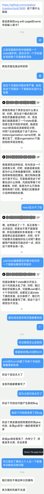
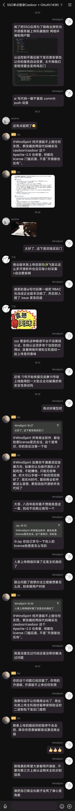

# Why not Casdoor

> **写作声明：本文完全由生成式大模型编写，未经任何人工 review。**
>
> 输入只有三样东西：当事人提供的 4 张聊天截图、2 封 GitHub 通知邮件的 `.eml` 原件，以及对 `casdoor/casdoor` 仓库的公开检索（git 历史、PR、issue、raw 文件）。文章的结构、措辞、结论均由模型生成；事实性内容逐条附链接，读者可自行复核。

- **对象**：`casdoor/casdoor`（Apache-2.0），核查时间 2026-11-17，仓库 HEAD `0256064a`。
- **当事人**：WindSpiritSR，2021、2025 两度向该项目提交代码的前 contributor；2026-11-16 被移出 Casdoor 与 Apache Casbin 两个 GitHub 组织（邮件原件见 [evidence/org-removal-emails.md](evidence/org-removal-emails.md)）。
- **许可**：CC BY-NC-SA 4.0（见 [LICENSE](LICENSE) 与文末"许可"一节）。

---

## 😅 TL;DR

1. **功能边界**：控制台导航 53 条，其中 17 条是 LLM/Agent 与电商（商品、优惠券、购物车、订单、支付、套餐、订阅、交易），另有 5 条被代码标记为仅企业版；`User` 结构体 183 个字段。
2. **默认值语义**：组织级 `navItems` 为"空即全部"。"用户取消勾选全部"与"从未配置"在数据层不可区分。2026-11-17 复核，这段逻辑与两年前完全一致（§1）。
3. **商业化方式**：配置 license 后，实例每小时上报主机名、机器指纹、私网 IP 与用户数；同一把 Ed25519 私钥既签 license，也签"升级指令"，`allowVendorUpgrade` 打开后厂商可让实例自行替换二进制（§6）。
4. **产出方式**：2026-11-10 单日 36 个 commit、639 个文件、约 3 万行新增；其中 15 分钟内 12 个 commit、1.58 万行，落地五个企业级子系统。这些提交全部直接推入 master，没有 PR、没有 review。44 个 commit 的作者是 `Copilot`，安全公告 0 条（§2、§8）。
5. **治理**：4368 个 commit 约 60% 出自同一人；2026 年 1220 个 commit 中仅 293 个带 PR 号；异议以"线下讨论"关闭（§9）。
6. **本文不反对商业化，反而认为大型开源项目必须把商业化的路走好**。批评的是把基础协议、基础授权能力和安全边界一起打包进 license 的做法，以及用"不配吃饭""你手搓一个"回避"如何可持续"的讨论（§7）。

---

## 🙃 1. 一个默认值：navItems、migrate 与"全不选等于全选"

Casdoor 的组织（Organization）可以配置"该组织的管理员能在左侧导航看到哪些页面"，值以 JSON 数组存放在 `navItems` 列；后来拆成两列：管理员的 `navItems`、普通用户的 `userNavItems`。

问题出在"历史值"上：功能上线前这一列不存在，数据库里为空。功能上线后，代码把"空"解释为"全部可见"：

```ts
/**
 * The organization can hide navbar entries: `navItems` for admins,
 * `userNavItems` for everyone else. Either being absent, not an array, or
 * containing "all" means "show everything" — the value Casdoor stores by default.
 */
function getNavItemFilter(account: Account): string[] | null {
  const organization = account.organization;
  const navItems = Setting.isLocalAdminUser(account) ? organization?.navItems : organization?.userNavItems ?? [];
  if (!Array.isArray(navItems) || navItems.includes("all")) {
    return null;
  }
  return navItems;
}
```

——[`web/src/lib/nav.ts:223-235`](https://github.com/casdoor/casdoor/blob/master/web/src/lib/nav.ts#L223-L235)

这段注释把问题写在了明面上：**"不存在"与"用户什么都没选"在数据层是同一个值**，而代码选择把它解释为"全部"。

### 🔍 2026-11-17 复核

针对这段逻辑是否仍在生效，本文于 2026-11-17 直接核对了 master，结论是仍然生效：

- `web/src/lib/nav.ts` 中 `getNavItemFilter()` 及上述注释**原样保留**，该文件最后一次提交是 2026-11-15 的 [`91ba94f1`](https://github.com/casdoor/casdoor/commit/91ba94f1)（`feat: hide the Casdoor Cloud links and upgrade offers by default in self-hosted community editions`）；
- `web/src/pages/OrganizationEditPage.tsx` 中 `checkedKeys={organization.navItems ?? ["all"]}` **仍然存在**（该文件最后一次提交为 2026-11-10 的 [`3d940179`](https://github.com/casdoor/casdoor/commit/3d940179)）；
- 这段逻辑没有随 2026-09 的控制台重写（[`2035ff56`](https://github.com/casdoor/casdoor/commit/2035ff56)）被清理，而是被原样搬进了新前端。

也就是说，**"空即全部"这个语义已经跨过了一次全量重写，活到了今天**。

### 🗯️ 当时的方案分歧

当事人提出的替代方案是：写一个 migrate 模块，在版本升级时把历史数据的"未配置"显式写成"全部"，让"空"只表示"用户真的什么都没选"（图 1、图 2）。

项目负责人的回应（语音转文字，图 1）：

> "我觉得这里可以先这样处理一下，就是说四个按钮儿都没选，就认为是都选了……只要这四个按钮儿都没显示，就等同于这四个按钮儿显示。"

> "这个 migration 之前就搞过，后来放弃了，因为太复杂了，维护这个 migration 非常麻烦啊，因为相当于带了一个很沉重的这个历史包袱……所以我觉得刚才说的那种方案就属于比较简单的。"

> "等版本过去好久以后，就是大家部署的人用的都是新版以后，我们再把这个东西纠正过来也是可以的啊。"

当事人的回应（图 2）：

> "你那个写法那不成故意写 bug 了。全不选等于全选。"

> "要是数据里 null = all，可以解释说是处理默认值；用户操作全不选，然后给人家显示上去，肯定是有问题的。"


### ↔️ 行为差异

- **旧控制台**（antd，`web-old`）：空数组会进入"条目数 ≤ 7 就扁平展示全部"的分支（[`web-old/src/App.js:167-190`](https://github.com/casdoor/casdoor/blob/master/web-old/src/App.js#L167-L190)），于是"全部取消勾选"真的变成"全部显示"；
- **新控制台**（shadcn）：空数组会被当作过滤条件，结果是一个空菜单——即"全部取消勾选"变成"什么都看不见"。同一份数据，两个前端给出相反的结果，这是语义不明确的直接后果。

**调查结论**：这不是一个 if 的问题。它的本质是**用运行时特判代替数据迁移**：语义被永久污染（任何读者都无法区分"没配过"和"全关掉"），用户操作被产品覆盖（明确的"全关掉"被解释为"全都要"），债务不消失只是转移（"以后大家升级完再纠正"的前提，是那时还存在可识别的旧数据，而这个特判本身会持续生产"空值"）。当时的判断——"这列的数据结构设计的挺烂的，有空得找人重写"——两年后依然成立；这列没有重写，而是从一列变成两列。

---

## 🚩 2. README 说 "One server, many protocols"，但协议可以按 license 收费

官方 README 的 ["Why Casdoor"](https://github.com/casdoor/casdoor#-why-casdoor) 写：

> "**One server, many protocols.** The same user directory is reachable over OAuth 2.0, OIDC, SAML 2.0, CAS, LDAP and SCIM, so a modern SPA and a legacy CAS-only app can share one set of accounts."

> "**Policy-based authorization built in.** Access rules are expressed with Casbin — ACL, RBAC, ABAC and custom models — rather than a fixed permission scheme."

这两段在 2026 年 11 月之前基本属实。之后不再是。

2026-11-09，仓库出现 `edition` 包（[`308e9e5c`](https://github.com/casdoor/casdoor/commit/308e9e5c)），引入 Community / Commercial / Enterprise 三档与 `edition.Require()` 调用。到 11-15，`edition.Require(` 已出现在 **27 个文件、67 处**。被标价的项目里，除了明显的企业治理能力（三权分立、防篡改审计、HSM、国密），还包括：

| 被标价的"功能" | 级别 | 证据 |
|---|---|---|
| SCIM Provisioning | Commercial | [`object/provisioning.go:114-116`](https://github.com/casdoor/casdoor/blob/master/object/provisioning.go#L114-L116) |
| MCP gateway / Keycloak syncer / "超过一个 syncer" | Commercial | [`edition/edition.go:43-79`](https://github.com/casdoor/casdoor/blob/master/edition/edition.go#L43-L79) |
| OpenTelemetry tracing | Commercial | 同上 |
| 签名密钥轮换 | Commercial | 同上 |
| ABAC | Commercial（至今） | [`web/src/lib/edition-features.ts`](https://github.com/casdoor/casdoor/blob/master/web/src/lib/edition-features.ts) |

SCIM 2.0 是一个标准协议，不是增值模块；可观测性与密钥轮换属于安全基线，不是"高级功能"。这份清单反映的不是产品分层，而是**按代码行数收费**。

### ⏱️ RBAC 的五天：一次没有人看过的变更

最典型的是 RBAC。11-10 00:14，[`25ee97ce`](https://github.com/casdoor/casdoor/commit/25ee97ce) 把 RBAC 放进商业版：只要权限模型里出现 `g`（分组/角色）规则，`CheckApiPermission` 与 `CheckLoginPermission` 就直接返回 license 错误。同一小时内另有 6 个 license/edition 相关提交。

24 小时后（11-11 10:14），一位外部使用者在该项目 v4.27.0 + Docker + MySQL 上撞到，提交 [#6077](https://github.com/casdoor/casdoor/issues/6077)。该作者 `xyz327` 在仓库中没有 commit、`author_association` 为 `NONE`——**第一个发现这次破坏性变更的人，既不是提交者，也不是任何 reviewer，而是一个装好即用的用户**：

> "RBAC MUST needs a commercial license its a breaking change. should noticed in release note"

项目负责人的回复（2026-11-15）：

> "Thanks for the report, you're right: v4.27.0 started rejecting RBAC (granting permissions by groups and roles, and `g` rules in enforcers) without a license, which broke existing setups on upgrade and wasn't mentioned in the release notes. Sorry about that."

> "Role inheritance is no longer silently skipped when loading grouping policies."

第二句比第一句严重：修复之前，加载分组策略时**角色继承被静默跳过**——不做继承展开，也不报错。那几天升级的实例，凡是依赖角色继承的权限判断，行为会在无日志、无告警的情况下改变。这不是许可策略，是授权引擎的正确性事故，起因只是"给 RBAC 加一个收费点"。

这次变更有三个特征，恰好构成一条完整的失守链路：

1. **没有被任何人看过。** 它不是 PR（没有 review），没有针对 licensing 分支的测试，也没有写进 release notes——负责人的回复本身承认了最后一点。如果提交前读过 diff，"`g` 规则被 license 拦截"本不需要一位外部用户来发现。
2. **不像是逐行手写的。** 同一作者在同一天落下 36 个 commit、639 个文件、约 3 万行新增；其中 15:49–16:04 的 15 分钟内 12 个 commit、269 个文件、15,761 行新增，平均每 75 秒一个 commit、每个 1,300 行。该仓库 `.gitignore` 收录了 `.claude`，也存在带 `Co-Authored-By: Claude 5.5 <noreply@anthropic.com>` 的提交（详见 §8）。把这批提交理解为"模型批量产出 + 直接推入 master"，是与全部证据最一致的解释。
3. **功能变更清单没有核对。** 一次同时引入 license、遥测、远程升级与 RBAC 门槛的改造，如果存在一份被逐项确认的变更清单，"是否破坏社区版 RBAC"应当是第一行，而不是发布后由用户报告。

五天后的 [`1dd4dfbb`](https://github.com/casdoor/casdoor/commit/1dd4dfbb) 把 RBAC 改回社区版，ABAC 继续收费。

**调查结论**：把 RBAC 当付费功能，说明设计者对"IAM 是什么"的理解是"功能清单"，而不是"授权模型"。RBAC 不是可插拔模块，它是 Casbin 的默认使用方式，是这个产品的地基。地基可以收费，但不能在用户盖好房子之后才告知地基要租。更严重的是，这次改动暴露了工作流本身：**模型产出直接进入授权热路径，人工 review 在链条上不存在**，正确性由第一个升级的用户承担。

---

## 🛒 3. 定位漂移：一个 IAM 里的商店、优惠券和购物车

以 2026-11-17 的 `web/src/lib/nav.ts` 为准，控制台导航共 **53 条**：

| 分组 | 条目数 | 内容 |
|---|---|---|
| Home | 3（+1 条件项） | Dashboard / Shortcuts / Apps，条件项为 Editions |
| User Management | 4 | Organizations / Groups / Users / Invitations |
| Identity | 7 | Applications / Providers / Marketplace / Integrations / Resources / Certs / Keys |
| Authorization | 8 | Roles / Permissions / Access reviews / Models / Adapters / Enforcers / Privileged accounts / Privileged access |
| LLM AI | 7 | Agents / MCP Servers / Tool call approvals / MCP Store / Entries / Sites / Rules |
| Auditing | 5 | Sessions / Records / Compliance / Tokens / Verifications |
| **Business** | **10** | **Product Store / Products / Coupons / Cart / Orders / Payments / Plans / Pricings / Subscriptions / Transactions** |
| Admin | 9 | System Info / Global Settings / Forms / Syncers / Webhooks / Webhook Events / Tickets / RADIUS Clients / Swagger |

53 条里，17 条是 LLM/Agent 与电商；另有 5 条被 `EnterpriseOnlyPages` 标记为仅企业版（Access reviews、Privileged accounts、Privileged access、Compliance、Tool call approvals）。旧控制台（`web-old`）的导航树是 44 条——**换了一版前端，条目从 44 涨到 53**。

这不是一天长成的：

- 2022-02-05，[`940aa2bc`](https://github.com/casdoor/casdoor/commit/940aa2bc) 加入支付页面（`Add payment pages.`）；
- 2022-02-27，[`39ab71c5`](https://github.com/casdoor/casdoor/commit/39ab71c5) 加入商品页面（`Add product pages.`）；
- 2026-04-17，[#5397](https://github.com/casdoor/casdoor/pull/5397) 加入"通用/商品/用户"三种作用域的优惠券系统；
- 组织模型里出现 `OrgBalance` / `UserBalance` / `BalanceCredit` / `BalanceCurrency`；用户模型里出现 `Balance` / `BalanceCredit` / `Currency` / `BalanceCurrency`，默认账户字段里还有 `Cart` 与 `Transactions`。

值得指出：`Add payment pages.` 与 `Add product pages.` 的作者是项目负责人本人。这不是"社区塞进来的东西"，而是项目定位的主动选择。

默认值更直接。`object/init.go` 定义每个组织默认展示的账户字段，其中包含：

```go
{Name: "Balance", Visible: true, ViewRule: "Self", ModifyRule: "Self"},
{Name: "Balance credit", ...},
{Name: "Balance currency", ...},
{Name: "Cart", Visible: true, ViewRule: "Self", ModifyRule: "Self"},
{Name: "Transactions", Visible: true, ViewRule: "Self", ModifyRule: "Self"},
...
{Name: "Score", Visible: true, ViewRule: "Public", ModifyRule: "Self"},
{Name: "Karma", Visible: true, ViewRule: "Public", ModifyRule: "Self"},
{Name: "Ranking", Visible: true, ViewRule: "Public", ModifyRule: "Self"},
```

——[`object/init.go:91-99`](https://github.com/casdoor/casdoor/blob/master/object/init.go#L91-L99)

一个全新的 IAM 部署，默认带着购物车和论坛积分。

再看数据模型：`User` 结构体 **183 个字段**（[`object/user.go:63`](https://github.com/casdoor/casdoor/blob/master/object/user.go#L63)），其中约 60 个是硬编码的第三方登录 ID 列（GitHub、Google、QQ、WeChat、DingTalk、Weibo、Gitee、LinkedIn、Wecom、Lark、Gitlab、Adfs、Baidu、Alipay、Apple、AzureAD、Slack、Steam、Bilibili、Okta、Douyin、Kwai、Line、Amazon、Auth0、BattleNet、Bitbucket、Box、CloudFoundry、Dailymotion、Deezer、DigitalOcean、Discord、Dropbox、EveOnline、Fitbit、Gitea、Heroku、InfluxCloud、Instagram、Intercom、Kakao、Lastfm、Mailru、Meetup、MicrosoftOnline、Naver、Nextcloud、OneDrive、Oura、Patreon、Paypal、SalesForce、Shopify、Soundcloud、Spotify、Strava、Stripe、Telegram、TikTok、Tumblr、Twitch、Twitter、Typetalk、Uber、VK、Wepay、Xero、Yahoo、Yammer、Yandex、Zoom……）。

**调查结论**：这不是"功能丰富"，是**没有抽象**。provider 本应是一行 `provider_type + external_id` 记录，而不是一列；每加一个 provider 都要改表结构、改 183 字段的表单、改 swagger、改 JWT claims。更现实的影响是攻击面：`pp/` 目录里有 11 个第三方支付网关（Adyen、Airwallex、Alipay、FastSpring、GC、LemonSqueezy、Paddle、PayPal、Polar、Stripe、WeChat Pay）外加一个余额支付实现，它们与 OIDC、SAML 运行在同一进程。IdP 的数据库因此进入支付合规的审计范围。一个"统一身份入口"变成"统一数据入口"，是架构问题，不是偏好问题。

---

## 👻 4. Casnode 的幽灵：没有"删除"这个动作的项目

Casdoor 早期有一个姊妹项目 Casnode（论坛）。为了让 Casnode 复用 Casdoor 的登录，Casdoor 里被塞进了一批只对论坛有意义的东西：

- `conf/app.conf` 的 `initScore = 2000`（[2021-08-03, #220](https://github.com/casdoor/casdoor/pull/220)）——今天仍在，默认值改为 `0`（[`conf/app.conf:16`](https://github.com/casdoor/casdoor/blob/master/conf/app.conf#L16)）；
- `user.score` / `user.karma` / `user.ranking` 三个字段，以及 2022 年新增的 `organization.initScore`（[#1388](https://github.com/casdoor/casdoor/pull/1388)）。

2025-01-04，当事人就此公开提问，issue [#3470](https://github.com/casdoor/casdoor/issues/3470)（`[question] Why an SSO platform include non-auth config item for specific app?`）：

> "The `initscore` configuration in Casdoor doesn't have any authentication-related functions but instead serves user information in Casnode. Why should an SSO handle data for specific applications? Will Casdoor eventually take over user information for all third-party applications?"

当天关闭，唯一回复：

> "Closed as we had offline discussion"

公开记录里没有留下任何关于"为什么 SSO 要承担论坛积分"的回答。同样的收尾方式在 [#3689](https://github.com/casdoor/casdoor/pull/3689) 上又出现了一次。

代码层面的证据更直接。2022-01-15 的 [`030c1caa`](https://github.com/casdoor/casdoor/commit/030c1caa)（commit message 为 `Fix bug in IsGlobalAdmin().`）做了这样一件事：

```go
func (c *ApiController) IsGlobalAdmin() bool {
	username := c.GetSessionUsername()
	if strings.HasPrefix(username, "app/") {
		// e.g., "app/app-casnode"
		return true
	}
	...
}
```

"是否为全局管理员"由**用户名字符串前缀**决定。这不是修 bug，这是在认证核心上为论坛开了一个后门；它在原地存在了**两年三个月**，直到 2024-04-24 的 [`af2d26da`](https://github.com/casdoor/casdoor/commit/af2d26da)（`Add object.IsAppUser()`）才被替换为正常的对象查询。

遗留物今天的形态：

- 每个用户的 ID Token 都携带论坛积分（[`object/token_jwt.go:286-288`](https://github.com/casdoor/casdoor/blob/master/object/token_jwt.go#L286-L288)）：

```go
Score:             user.Score,
Karma:             user.Karma,
Ranking:           user.Ranking,
```

- 同步器把 `Score` 当作"隶属关系索引"，映射不到直接 panic（[`object/syncer_util.go:118-126`](https://github.com/casdoor/casdoor/blob/master/object/syncer_util.go#L118-L126)）：

```go
if affiliationMap != nil {
    if originalUser.Score != 0 {
        affiliation, ok := affiliationMap[originalUser.Score]
        if !ok {
            panic(fmt.Sprintf("Affiliation not found: %d", originalUser.Score))
        }
        user.Affiliation = affiliation
    }
}
```

- `Ranking` 的计算方式是"当前用户总数 + 1"（[`object/user.go:1228-1235`](https://github.com/casdoor/casdoor/blob/master/object/user.go#L1228-L1235)），所有人几乎并列，唯一作用是让字段看起来有值。

**调查结论**：一个项目的工程能力，很大程度体现在它敢删什么。Casdoor 六年来主动移除的功能屈指可数，新增功能从不退场，模型因此变成沉积岩：每换一次业务方向就多一层再也不会被清理的字段。第 1 节的 `navItem` 是同一个病的另一种表现——不是"没时间迁移"，而是**从来没有"清理"这个动作**。

---

## 🫠 5. "改动太大"：67 个字段、一个 state，和一个被线下关掉的 PR

旧控制台的每个编辑页，都是"一个巨大的 state 对象 + 受控组件"。以组织编辑页为例：

- `Organization` 结构体 **67 个字段**（[`object/organization.go:52`](https://github.com/casdoor/casdoor/blob/master/object/organization.go#L52)）；
- `web-old/src/OrganizationEditPage.js` **985 行**；
- 应用编辑页 `ApplicationEditPage.js` **1890 行**，`Application` 结构体 **107 个字段**；
- 用户编辑页 `UserEditPage.js` **1631 行**，`User` 结构体 **183 个字段**。

所有字段共享同一个 `this.state.organization`：改任何一个字段，整个页面重渲染。组织的 name 字段是最明显的受害者——每敲一个字符，几百个受控组件一起 diff。

2025-03-29，当事人提交 [PR #3689](https://github.com/casdoor/casdoor/pull/3689)（`improve: org edit form`），把它改成按字段订阅。PR 描述给出了实测数据：

> "Before: 161.11 ms per keystrokes event"
>
> "After: 2.3 ms per keystrokes event"
>
> "The page functionality has not been fully tested. Please conduct internal functional testing first."

项目负责人的反应（图 3）：

> "这个修改也没什么意义呀……react 的渲染应该能够区分吧？"

> "为什么只有他很特殊呢？那我们还要做多少这种特殊的处理。"

> "但是如果每个 state 都分开定义，这个代码就太乱了呀……比如 user 都几十个字段对吧，全都定义成 state 下面的变量，这太麻烦了，我们代码都要全都重写了啊。"

> "你这个改动太大了。全部页面都要重写了。你这个代码也可能产生新的 Bug。"

> "你这个其实跟说把阿里的所有 Java 代码全用 Go 改写一遍的意思差不多。改成 Go 肯定是快了，内存少了，但是成本太高，无法承受。"

> "我们现在不做这种大的重构，各方面时机都不合适。"



该 PR 的结局：**没有任何 review 记录，负责人没有在 PR 上留下任何文字**，2025-04-07 以 `Closed as discussed offline` 关闭。当事人在该仓库共提交 42 个 PR，全部关闭，0 个处于打开状态；5 个 issue 也全部关闭——其中 [#101](https://github.com/casdoor/casdoor/issues/101)（ESLint/EditorConfig，仓库里现在有 `.eslintrc` 与 `.editorconfig`）和 [#210](https://github.com/casdoor/casdoor/issues/210)（表格重复 key，被标 `released`）被采纳，[#3470](https://github.com/casdoor/casdoor/issues/3470) 与 [#3677](https://github.com/casdoor/casdoor/issues/3677) 则分别以"线下讨论"和 `wontfix` 结束。

同一时期还有一件更小的议题：把散落在各页面的 `fetch` 调用换成 axios，用拦截器统一处理请求与错误响应。2025-03-22 的 issue [#3677](https://github.com/casdoor/casdoor/issues/3677)（`[Refactor] Replace fetch with axios`）把方案写成四条可执行项：

> "Encapsulate the axios request into a `request()` method, which should include `interceptors.request` and `interceptors.response`."

> "By default, handle API errors in the interceptor and display them as `Message` prompts."

> "Allow the `request()` method to accept options such as `ignoreError: true` to pass errors to the business code."

> "The functionality for this refactoring issue should be submitted to the `refactor-axios` branch."

一个月后，该 issue 被打上 `wontfix` 并关闭，唯一回复：

> "Not bad but not recently planned"

**调查结论**：负责人说"改动太大"是事实，但"大"的原因不是改动本身，而是仓库**没有类型、没有组件边界、没有测试**，所以任何改动都显得大。同一批页面在 2026-09 被整体重写为 shadcn/ui（[`2035ff56`](https://github.com/casdoor/casdoor/commit/2035ff56)）：当初"太大不能做"的事，17 个月后以十倍代价发生了一次，区别只是那次重写由负责人自己主导。而"减少重复"的改动（axios 统一请求层）被标记为 wontfix，重复因此留在了代码里——1890 行的编辑页与 183 字段的模型，正是重复的产物。

---

## 💀 6. 六天造出一个"企业版"

2026-11-09 到 11-15，仓库完成了一次商业化改造。时间线如下（均可点开）：

| 日期 | commit | 内容 |
|---|---|---|
| 11-09 | [`308e9e5c`](https://github.com/casdoor/casdoor/commit/308e9e5c) | `feat: add edition license support`，引入 Ed25519 license 与 `edition` 包 |
| 11-10 | [`e5eb7c8c`](https://github.com/casdoor/casdoor/commit/e5eb7c8c) | `feat: report the license hourly and support offline activation` |
| 11-10 | [`d8de5913`](https://github.com/casdoor/casdoor/commit/d8de5913) | `feat: report the environment of a licensed instance and let the license server ask it to upgrade` |
| 11-10 | [`038cac37`](https://github.com/casdoor/casdoor/commit/038cac37) | `feat: let a license grant RBAC and ABAC on their own` |
| 11-10 | [`25ee97ce`](https://github.com/casdoor/casdoor/commit/25ee97ce) | `... allow RBAC, ABAC and more syncers from the commercial edition` |
| 11-10 | [`3d940179`](https://github.com/casdoor/casdoor/commit/3d940179) | 国密、三权分立、防篡改、字段加密、职责分离、合规页一次性加入 |
| 11-10 | [`aeeb3bb2`](https://github.com/casdoor/casdoor/commit/aeeb3bb2) / [`1c837903`](https://github.com/casdoor/casdoor/commit/1c837903) | UKey / 证书登录、PKCS#11 HSM |
| 11-15 | [`1dd4dfbb`](https://github.com/casdoor/casdoor/commit/1dd4dfbb) | RBAC 回滚 |

从第一行 license 代码到功能表补齐、再到第一次回滚，前后 **5 天 17 小时**。仓库没有分支保护、没有设计评审、没有安全评审。

### 📡 遥测：一份 license 对应一份机房清单

实例配置 license 后，`reportLoop()` 在启动一分钟后开始、每小时一次向 license 服务器 POST 一份 JSON（[`edition/report.go:143-180`](https://github.com/casdoor/casdoor/blob/master/edition/report.go#L143-L180)）：

```go
res := map[string]interface{}{
	"license":     text,
	"instanceId":  getInstanceId(),
	"fingerprint": getFingerprint(),
	"hostname":    hostname,
	"version":     getVersion(),
	"edition":     Get(),
	"userCount":   userCount,
	"environment": collectEnvironment(),
	"upgrade":     upgradeState,
}
```

其中 `fingerprint` 的计算方式（[`edition/report.go:79-104`](https://github.com/casdoor/casdoor/blob/master/edition/report.go#L79-L104)）是：读取 `/etc/machine-id` 或 `/var/lib/dbus/machine-id`，读不到则枚举所有网卡 MAC，拼上 hostname，做 SHA-256。`environment`（[`edition/environment.go:35-55`](https://github.com/casdoor/casdoor/blob/master/edition/environment.go#L35-L55)）包含：

```go
Os, Platform, Kernel, Arch, Virtualization,
CpuModel, CpuCores, MemoryTotal, DiskTotal, DiskFree,
Deployment, Supervisor, DbType, DbVersion,
GoVersion, Origin, PrivateIps, StartTime, TimeZone
```

`PrivateIps` 会把实例所在内网的 IP 列表（最多 8 个）一并送出（[`edition/environment.go:73-91`](https://github.com/casdoor/casdoor/blob/master/edition/environment.go#L73-L91)）。

需要准确说明：**社区版（无 license）不上报任何内容**——`report()` 在 `license == nil` 时直接返回。这一点在群聊中被强调过：

> "纯开源版不上报任何东西。……群友截的两段代码确实在 casdoor/casdoor 这个 Apache-2.0 仓库里，但都在 license 门槛后面，不是'开源版也在传'。"

该说法在技术上成立。问题在于："门槛后面"意味着**付费之后，机房清单开始每小时流向厂商服务器**；而销售页面（`casdoor.cn/pricing`）只写"商业版、企业版、信创版都是私有化部署，按项目报价"，没有任何一条提到上述数据项。



### ⬆️ 远程升级：签 license 的私钥，也在签"替换你自己"的指令

`edition` 包在二进制中硬编码了一个 Ed25519 公钥（[`edition/edition.go:105`](https://github.com/casdoor/casdoor/blob/master/edition/edition.go#L105)）：

```go
var publicKey = ed25519.PublicKey(mustDecodeBase64("yu3Y2GTk/CNjdXfooXzLVUDCo19jTV3VXVDFLdHu+Bg="))
```

这把公钥验证两类对象：

1. **license**：`<base64 payload>.<base64 signature>`；
2. **upgrade order**（[`edition/upgrade_order.go:29-41`](https://github.com/casdoor/casdoor/blob/master/edition/upgrade_order.go#L29-L41)）：

```go
// UpgradeOrder is the vendor asking this instance to move to a release, signed by the same key as the license; the
// checksums (by release package name) let it install a package from a mirror or one uploaded by hand
type UpgradeOrder struct {
	Type       string            `json:"type"`
	Id         string            `json:"id"`
	License    string            `json:"license"`
	InstanceId string            `json:"instanceId,omitempty"`
	Version    string            `json:"version"`
	Note       string            `json:"note,omitempty"`
	Checksums  map[string]string `json:"checksums,omitempty"`
	...
}
```

收到 order 后的处理（[`upgrade/upgrade.go:456-473`](https://github.com/casdoor/casdoor/blob/master/upgrade/upgrade.go#L456-L473)）：

```go
// onUpgradeOrder starts the upgrade a new order asks for when the admin let the vendor upgrade this instance
func onUpgradeOrder(order *edition.UpgradeOrder) {
	if !isVendorUpgradeAllowed() || !isOrderPending(order) || !canInstallHere() || isUpgrading(getStatus().State) {
		return
	}
	err := startOrderedUpgrade(order, "", "the license server")
	...
}
```

`isVendorUpgradeAllowed()` 读取 `app.conf` 的 `allowVendorUpgrade`，**默认关闭**。这一点必须承认：默认情况下厂商推不动实例。但代价是：

- 打开该开关的客户，把**版本替换权**交给厂商：可以强制升到某个版本，也可以把版本钉在某个 tag；
- 该权力的唯一凭据，与 license 是同一把私钥；
- 在线路径上，包仍从 `github.com/casdoor/casdoor/releases/download/<tag>` 下载并校验 SHA-256——**仅持有签名私钥**最多能让实例安装一个**已发布的** Casdoor 版本；"任意二进制"还需要同时拥有仓库的 release 发布权限；
- 离线路径（管理员上传安装包 + 厂商签名的 order）中，`InstallUploadedPackage` 唯一的校验依据是 order 里的 checksum（[`upgrade/install.go:339-352`](https://github.com/casdoor/casdoor/blob/master/upgrade/install.go#L339-L352)），不校验来源——签名私钥因此也是一张"离线包通行证"；
- 结论：**同时持有私钥与发布权限的人，即客户的发布流水线**；这两样都在厂商手里。

该机制没有透明度日志、没有版本固定策略、没有第三方可验证的签名公示。客户唯一能确认的是"这个包来自 casdoor/casdoor 的某个 release"——而 release 可以被删除和重传。

### 📜 同期加入的安全条款

2026-11-09——license 代码合入的同一天——`SECURITY.md` 增加了（[`6276d80d`](https://github.com/casdoor/casdoor/commit/6276d80d)）：

> "We do not accept AI-generated security reports. We receive a large number of these, and we absolutely do not have the resources to review them all. If you submit one, that will be an automatic ban from the project."

> "The same applies to using AI tools to run automated vulnerability scans, fuzzing, or penetration testing against this project or any of its hosted instances..."

同期 GitHub Security Advisories 页面为 **0 条**（[链接](https://github.com/casdoor/casdoor/security/advisories)）。

**调查结论**：软件收费本身不是问题。问题在于**用 license 校验充当安全边界**：一个自托管 IAM 的价值在于"凭证不出机房"，而这个设计把它改成"凭证不出机房，但机房清单每小时上报一次，且厂商持有一把能让实例替换版本的钥匙"。架构上这叫"厂商即 root"，合规上叫"供应链风险"，产品页上叫"企业版"。同时，"拒绝 AI 生成的漏洞报告"与"自动封禁"的组合，使得外部安全研究者面对该项目时的预期收益为负——这与 0 条安全公告互为因果。

---

## 🍚 7. 关于商业化：批评的不是收费，是收费的方式

有必要单独澄清一个被反复误读的立场：**当事人从未反对商业化。**

更进一步：**当事人始终认为，大型开源项目必须把商业化的路走好，才谈得上可持续发展。** 协议实现、安全响应、版本维护、文档与支持都是长期成本；没有稳定收入，就只能靠个人热情和志愿者时间硬撑。Casdoor 今天的很多问题——单人提交占 60%、没有 reviewer、0 条安全公告、发版即坏——恰恰是"把商业化等同于加一道 license 校验、而工程投入没跟上"的结果，而不是"商业化走得太远"的结果。

因此，批评的对象从来不是收费本身，而是三件具体的事：

1. **把基础能力当作 license 门槛**：RBAC 曾是（#6077，五天后回滚），ABAC 现在仍是；SCIM provisioning 与密钥轮换仍在清单里。基础协议与授权模型属于 IAM 的地基，把它们作为付费项，等价于把"能不能正确鉴权"作为商品。
2. **把遥测打包进 license**：主机名、机器指纹、私网 IP、用户数、CPU/内存/磁盘、数据库版本，全部随 license 校验一并上报，且不在销售页披露。若需要这些数据，正确的做法是 opt-in、明示清单、提供关闭开关与数据处理协议。
3. **把安全边界押在签名私钥上**：同一把钥匙既签发授权，也签发"替换二进制"，且没有透明度机制。

而在这类讨论中，对方反复使用的回应是转移话题。群聊原文（图 4）：

> "如果你不满意项目发展方向，如果你认为搞开源的人不配吃饭、不配赚钱，只能无偿奉献，你大可以手搓一个新的项目就好了。"

> "所有商业软件，都会检查 license 是否合法，这个是常识，你的言论注意一下哈。"

这两句话回应的是"你反对商业化"，而实际被提出的问题是"为什么检查 license 需要上报私网 IP 和机器指纹"。前者是动机指控，后者是技术问题；用前者替代后者，讨论就无法进行。

**调查结论**：可持续的商业化是大型开源项目唯一现实的出路，这一点没有争议；有争议的是路径。可行的路径包括：明确 open core 边界（哪些能力永远开源、哪些是企业功能）、遥测 opt-in 与文档化、签名与发布的透明化（独立密钥、公开审计日志）、版本支持策略与 CVE 流程、以及把贡献者留在组织里的治理结构。把"要不要吃饭"当作挡箭牌，恰恰回避了"怎样让社区一起吃饭"这个更难、也更有价值的问题。

---

## 🙈 8. 质量门：2047 个 tag、44 个 Copilot 提交、0 个安全公告

可在仓库核对的数字：

| 指标 | 数值 |
|---|---|
| tag 总数 | 2047（最新 `v4.29.0`；`v4.28.0` 与 `v4.29.0` 同日发布） |
| commit 总数 | 4368 |
| 2026 年 commit | 1220（历史最高，比 2023 年的 869 高约 40%） |
| author 为 `Copilot` 的 commit | 44（2025-10 至 2026-02） |
| 测试文件 / Go 文件 | 35 个 `_test.go` / 598 个 `.go`（CI 含 `go test` 与 Cypress e2e） |
| merge commit | 35 |
| 安全公告 | 0 |

具体切片：

- **AI 生成的 PR 直接合并**：[#4408](https://github.com/casdoor/casdoor/pull/4408)（`feat: add CLI "export" arg to support exporting data to file`）作者为 Copilot，从打开到合并 **35 分钟**、**0 条 review**；[#5009](https://github.com/casdoor/casdoor/pull/5009)（`feat: fix CAPTCHA rule enforcement in verification code flow`）的 4 条 review 全部来自 `copilot-pull-request-reviewer[bot]`，无人类评审记录。这不是"使用 AI 辅助"，而是把合并权限交给了 AI。
- **发版即坏**：[#5844](https://github.com/casdoor/casdoor/issues/5844)，`v4.4.0` 在 MySQL 9.7.1 / 8.4.10 上初始化失败（`user.password_history` 触发 Error 1118），而 `v4.3.0` 在同一数据库上正常。一次表结构变更，看不出在发版前跑过新版本 MySQL 的证据。
- **安全加固被回滚**：2023-07，[#2118](https://github.com/casdoor/casdoor/pull/2118) 为 CAS 登录加入 `service` 白名单校验（`CheckCasRestrict`），针对的是"CAS ticket 被重定向到攻击者服务"一类问题。一个月后，[#2234](https://github.com/casdoor/casdoor/pull/2234) 将其整体 revert：**PR 从打开到合并 7 分钟**，正文仅一行 `Reverts casdoor/casdoor#2118`，没有理由说明。

### 🧬 谁在写这些代码

| 时间窗 | commit 数 | 文件 | 新增行 | 删除行 |
|---|---|---|---|---|
| 2026-11-10 全天 | 36 | 639 | 30,100 | 787 |
| 2026-11-10 15:49–16:04 | 12 | 269 | 15,761 | 291 |
| 2026-11-09 至 11-16 | 87 | 1,157 | 44,018 | 1,898 |

（统计口径：`git log --author="Yang Luo" --numstat`，按作者日期切分。）

15:49–16:04 的这 12 个 commit 包括：特权账号管理（41 文件 / 4,164 行）、访问复审与委派管理（60 文件 / 4,481 行）、PKCS#11 HSM（49 文件 / 2,104 行）、UKey 与证书登录（42 文件 / 1,984 行）、安全态势大屏与 Word 报告（23 文件 / 2,467 行）。**15 分钟内落地五个互不相同、每个横跨 20–60 个文件的企业级子系统**，且每个都连带更新了 10 余种语言的 i18n 词条。

一个人可以在 15 分钟里敲完一个文件；不可能在 15 分钟里完成五个子系统的设计、实现、前端页面、10 种语言词条与 swagger。这不是"写得快"，是批量落盘。

其他可核对的信号：

- 这 36 个 commit 全部直接推入 master；2026 年 1220 个 commit 中，只有 293 个带 PR 号；
- 44 个 commit 的 author 是 `Copilot`，其中 [#4408](https://github.com/casdoor/casdoor/pull/4408) 从打开到合并 35 分钟、0 条 review；
- 2 个 commit 带 `Co-Authored-By: Claude 5.5 <noreply@anthropic.com>`（[`54854556`](https://github.com/casdoor/casdoor/commit/54854556)、[`de30b934`](https://github.com/casdoor/casdoor/commit/de30b934)），内容是一次安全修复；
- `.gitignore` 中有一条 `.claude`（[`84f289dd`](https://github.com/casdoor/casdoor/commit/84f289dd)，`fix: ignore claude config`）。

**该仓库的实际工作流**：模型生成 → 直接推送 → 用户发现问题 → 再让模型修。人工 review 在这个循环里没有位置；CI 只跑既有测试，而新功能通常没有对应测试。

**调查结论**：这不是"迭代快"，而是**没有质量门**。快速发布不是罪；罪在于没有任何机制能在发布前拦截一次坏的表结构变更、一次被回滚的安全修复、或一个 35 分钟合并的 AI 生成变更。2047 个 tag 说明的是"发布没有成本"，不是"产品稳定"。

---

## 🫡 9. 治理：一个人的仓库，和一群人的时间

```text
2579  Yang Luo
 501  Gavin Wayne
 330  DacongDA
 291  Gucheng Wang
 163  Yaodong Yu
  68  IsAurora6
  58  Yixiang Zhao
  46  hsluoyz        # 同一个人
  44  Copilot
```

4368 个 commit 中约 60% 出自同一人；将 `hsluoyz` 与 `Yang Luo` 合并计算为 2625 个。2026 年的 1220 个 commit 里，只有 **293 个**带 PR 号（`(#NNNN)`），其余四分之三是**直接推入 master**——没有 review，除 CI 之外没有任何门。

这不是猜测。Casdoor 的早期成长很大程度上依赖社区活动：

- **OSPP 暑期 2021**（开源软件供应链点亮计划）：Casbin 社区的项目列表中包含"Casdoor 身份认证系统（前端 React + Javascript，后端 Golang）"，难度"高"，**社区导师：罗杨（hsluoyz）**——[casbin/Summer2021](https://github.com/casbin/Summer2021)；
- **OSPP 暑期 2022**："Casdoor 单点登录系统、Casnode 社区系统（前端 React + JS，后端 Go）"，**主导师：罗杨**——[casbin/Summer2022](https://github.com/casbin/Summer2022)；
- **GSoC 2021**（组织 Casbin）：项目 "Refactor Casbin.js and other optimizations on pycasbin and node-casbin"，导师名单包含 Yang Luo——[归档](https://summerofcode.withgoogle.com/archive/2021/projects/4787500660293632)；
- **GSoC 2022**（组织 Casbin）：项目 "Casbin for Cloud Native & Casdoor"，提案第三部分为"push forward the development Casdoor"——[归档](https://summerofcode.withgoogle.com/archive/2022/projects/zI13Fc3W)。

当事人的首批提交（[#79](https://github.com/casdoor/casdoor/pull/79) Facebook provider、[#160](https://github.com/casdoor/casdoor/pull/160) LDAP 支持）出现在 2021 年 6–7 月，与上述周期重合。该阶段的工作模式是：提交 PR，负责人浏览后合并。没有设计文档，没有架构评审，没有人为"这个功能该不该进入该产品"负责——**导师同时是产品经理、架构师、唯一评审与唯一合并者，评审带宽 = 1**。

一个与刻板印象相反的观察：在该项目中，学生 PR 通常会被反复要求修改，最终合入的代码至少经过两轮阅读；而负责人的提交是直接推送的，缺陷由用户在发布后发现。第 4 节的 panic、第 8 节的启动失败，都属于这一类。因此"学生代码质量差"的解释在本仓库并不成立：**没有 review 的那部分才是风险源**。

另一个结构性事实：负责人的功能参与方式是"自己写"——商品页、支付页、MCP/Agent 均为其本人 commit；架构参与方式则是"不参与"。一个 owner 同时是产品经理、架构师、评审人、合并者与最大功能提交者，意味着**不存在结构性的否决点**。这不是能力问题，是结构问题；而结构由他自己选择。

关于个人的技术能力：公开资料显示其为 Npcap 的原始作者（nmap/npcap 仓库历史 README 的表述为 "developed by Yang Luo under Google Summer of Code 2013 and 2015"，其 GitHub 简介为 "Nmap member. Original author of Nmap's Npcap, Casbin, Casdoor, OpenAgent"）。本文批评的是工程与治理，不涉及个人技术能力。

### 🚪 被移出组织

2026-11-16 北京时间 19:08，当事人收到两封 GitHub 通知邮件，时间相差 1 秒：

- `19:08:38` —— `[GitHub] You've been removed from the "Apache Casbin (Incubating)" organization`
- `19:08:39` —— `[GitHub] You've been removed from the "Casdoor" organization`

两封邮件的分类头均为 `categories: org,org-remove-member`，即"组织成员被移除"，不是仓库权限调整。原文归档于 [evidence/org-removal-emails.md](evidence/org-removal-emails.md)，`.eml` 原件（含完整 MIME 与 DKIM/SPF/DMARC 通过记录）同目录。

有据可查的时间线：

| 时间 | 事件 |
|---|---|
| 11-09 | `SECURITY.md` 加入"提交 AI 生成的漏洞报告会被自动封禁" |
| 11-10 | 商业版功能（license、遥测、远程升级）合入 |
| 11-16 19:08:38 | 被移出 Apache Casbin (Incubating) 组织 |
| 11-16 19:08:39 | 被移出 Casdoor 组织 |

图 4 那轮群内争论的截图时间为 18:07–18:37，但截图本身不带日期，因此本文不将其作为因果证据；可以确认的是：在那几天里，当事人在公开群中质疑的正是遥测与远程升级这两件事，而移除发生在 11-16 晚间。相隔一秒的两封邮件只能解释为同一次操作——Casbin 与 Casdoor 由同一作者创建，管理员为同一批人。

**调查结论**：项目管理者的时间应当用于让项目更可靠，而不是用于管理提出问题的入口。一个以"自动封禁"回应安全报告、以"线下讨论"关闭架构质疑、以"手搓一个"回应商业化质疑的项目，事实上已经放弃了外部纠错机制；而一个没有外部纠错机制的 IAM，不适合承载企业身份。

---

## 🧭 10. 选型建议

需要说明的是，Casdoor 并非没有优点：

- **功能覆盖广**：OIDC / SAML / CAS / LDAP / WebAuthn / TOTP 均有实现，UI 完整，开箱可跑；
- 对**小团队做演示或内网工具**，它比 Keycloak 轻，比自研快；
- **SDK 生态**（Go/Java/Python/Node/.NET/PHP/Rust）是实打实的投入；
- 文档与 demo 站（`demo.casdoor.com`）优于多数同类开源项目。

问题在于**准备用它承载什么**。如果它后面接的是公司的全部系统，购买的就不是"一个登录页"，而是"权限的根"。对根的要求只有两个字：**正确**。而在"正确"这一维度上，现状是：183 字段的模型、2047 个没有质量门的版本、0 条安全公告、一个把 license 私钥同时当作远程升级凭据的商业版。

### 🧮 替代方案

| 场景 | 建议 | 取舍 |
|---|---|---|
| 企业级、需要 SAML/LDAP/多租户、可接受 Java | **Keycloak** | 重、配置复杂、UI 陈旧；协议实现经十年打磨，社区与商业支持成熟 |
| 云原生、需要现代 API 与 OIDC-first | **Zitadel** | Go 编写、多租户设计干净、事件溯源；生态小于 Keycloak |
| 自托管、需要 OIDC 代理 + 轻量 IdP | **Authentik** | Python、流程引擎灵活；性能一般 |
| 仅需网关层认证 | **Ory Hydra / Kratos** 或 **oauth2-proxy / Authelia** | 只做一件事，做好一件事 |
| 需要中国区合规、等保、国密 | Keycloak + 国产化改造，或商业 IAM | 需自行适配与审计 |

### 🧷 如果必须使用 Casdoor

1. **锁定版本**，不要跟随 `latest`。2047 个 tag 中包含大量热修。
2. **不购买商业版**，除非能接受每小时上报主机指纹与私网 IP，并取得对应数据处理协议；若已购买，保持 `allowVendorUpgrade` 关闭。
3. **不启用 Business 分组**（商品/优惠券/订单/支付），避免 IdP 进入支付合规范围。
4. **只暴露必要的协议端点**，将其视为不可信组件，置于反向代理之后。
5. **自行阅读 `object/check.go`、`controllers/base.go`、`object/token_*.go`**：授权与令牌是 IdP 的全部，这几个文件合计不到 5000 行。
6. **不要把 `navItems` 的空值当作"未配置"**。

---

## 📎 附录 A：证据索引

| # | 论点 | 证据 |
|---|---|---|
| 1 | navItems 空值 = 全部可见（2026-11-17 复核未变） | [`web/src/lib/nav.ts:223-235`](https://github.com/casdoor/casdoor/blob/master/web/src/lib/nav.ts#L223-L235)、[`OrganizationEditPage.tsx:745`](https://github.com/casdoor/casdoor/blob/master/web/src/pages/OrganizationEditPage.tsx#L745)、[`web-old/src/App.js:167-190`](https://github.com/casdoor/casdoor/blob/master/web-old/src/App.js#L167-L190) |
| 2 | "全不选等于全选"的原始沟通 | 图 1、图 2（语音转文字） |
| 3 | RBAC 曾被 license 拒绝 | [`25ee97ce`](https://github.com/casdoor/casdoor/commit/25ee97ce)、[#6077](https://github.com/casdoor/casdoor/issues/6077)、回滚 [`1dd4dfbb`](https://github.com/casdoor/casdoor/commit/1dd4dfbb) |
| 4 | SCIM 属于付费功能 | [`object/provisioning.go:114-116`](https://github.com/casdoor/casdoor/blob/master/object/provisioning.go#L114-L116) |
| 5 | 商业功能清单与 67 处 `Require` | [`edition/edition.go:43-79`](https://github.com/casdoor/casdoor/blob/master/edition/edition.go#L43-L79) |
| 6 | 商业模块（商品/优惠券/订单/支付） | [`940aa2bc`](https://github.com/casdoor/casdoor/commit/940aa2bc)、[`39ab71c5`](https://github.com/casdoor/casdoor/commit/39ab71c5)、[#5397](https://github.com/casdoor/casdoor/pull/5397) |
| 7 | 默认账户字段含 Cart/Balance/Score/Karma/Ranking | [`object/init.go:91-99`](https://github.com/casdoor/casdoor/blob/master/object/init.go#L91-L99) |
| 8 | User 183 字段 / Organization 67 / Application 107 | [`object/user.go:63`](https://github.com/casdoor/casdoor/blob/master/object/user.go#L63)、[`object/organization.go:52`](https://github.com/casdoor/casdoor/blob/master/object/organization.go#L52)、[`object/application.go:96`](https://github.com/casdoor/casdoor/blob/master/object/application.go#L96) |
| 9 | Casnode 遗留：initScore | [`conf/app.conf:16`](https://github.com/casdoor/casdoor/blob/master/conf/app.conf#L16)、[#220](https://github.com/casdoor/casdoor/pull/220)、[#1388](https://github.com/casdoor/casdoor/pull/1388) |
| 10 | `IsGlobalAdmin` 的 `app/` 前缀判断 | [`030c1caa`](https://github.com/casdoor/casdoor/commit/030c1caa)、移除 [`af2d26da`](https://github.com/casdoor/casdoor/commit/af2d26da) |
| 11 | JWT 携带 score/karma/ranking | [`object/token_jwt.go:286-288`](https://github.com/casdoor/casdoor/blob/master/object/token_jwt.go#L286-L288) |
| 12 | syncer 以 score 为索引并 panic | [`object/syncer_util.go:118-126`](https://github.com/casdoor/casdoor/blob/master/object/syncer_util.go#L118-L126) |
| 13 | ranking = 用户总数 + 1 | [`object/user.go:1228-1235`](https://github.com/casdoor/casdoor/blob/master/object/user.go#L1228-L1235) |
| 14 | 性能 PR 被线下关闭 | [#3689](https://github.com/casdoor/casdoor/pull/3689)（`Closed as discussed offline`） |
| 15 | "改动太大"的原始沟通 | 图 3 |
| 16 | 2026-09 全量重写控制台 | [`2035ff56`](https://github.com/casdoor/casdoor/commit/2035ff56) |
| 17 | 遥测内容与频率 | [`edition/report.go:79-104`](https://github.com/casdoor/casdoor/blob/master/edition/report.go#L79-L104)、[`edition/report.go:143-180`](https://github.com/casdoor/casdoor/blob/master/edition/report.go#L143-L180)、[`edition/environment.go:35-91`](https://github.com/casdoor/casdoor/blob/master/edition/environment.go#L35-L91) |
| 18 | 远程升级（license server 下发 order） | [`edition/upgrade_order.go:29-41`](https://github.com/casdoor/casdoor/blob/master/edition/upgrade_order.go#L29-L41)、[`upgrade/upgrade.go:456-473`](https://github.com/casdoor/casdoor/blob/master/upgrade/upgrade.go#L456-L473)、[`upgrade/install.go:339-352`](https://github.com/casdoor/casdoor/blob/master/upgrade/install.go#L339-L352) |
| 19 | SECURITY.md 封禁条款 | [`6276d80d`](https://github.com/casdoor/casdoor/commit/6276d80d)、[SECURITY.md](https://github.com/casdoor/casdoor/blob/master/SECURITY.md) |
| 20 | 0 条安全公告 | [Security Advisories](https://github.com/casdoor/casdoor/security/advisories) |
| 21 | 发版即坏（v4.4.0 / MySQL） | [#5844](https://github.com/casdoor/casdoor/issues/5844) |
| 22 | CAS 安全加固被 7 分钟回滚 | [#2118](https://github.com/casdoor/casdoor/pull/2118)、[#2234](https://github.com/casdoor/casdoor/pull/2234) |
| 23 | Copilot 生成并合并的 PR | [#4408](https://github.com/casdoor/casdoor/pull/4408)、[#5009](https://github.com/casdoor/casdoor/pull/5009) |
| 24 | OSPP / GSoC 与导师 | [casbin/Summer2021](https://github.com/casbin/Summer2021)、[casbin/Summer2022](https://github.com/casbin/Summer2022) |
| 25 | Npcap 作者署名 | [nmap/npcap 历史 README](https://raw.githubusercontent.com/nmap/npcap/fake_service/README.md)、[hsluoyz 的 GitHub 简介](https://github.com/hsluoyz) |
| 26 | axios 重构 issue 被打 `wontfix` | [#3677](https://github.com/casdoor/casdoor/issues/3677) |
| 27 | 质询 `initscore` 被"线下讨论"关闭 | [#3470](https://github.com/casdoor/casdoor/issues/3470) |
| 28 | 被移出 Casdoor / Apache Casbin 组织 | [evidence/org-removal-emails.md](evidence/org-removal-emails.md)（含两封 `.eml`） |
| 29 | 导航条目 44 → 53 | [`web-old/src/common/NavItemTree.js`](https://github.com/casdoor/casdoor/blob/master/web-old/src/common/NavItemTree.js)、[`web/src/lib/nav.ts`](https://github.com/casdoor/casdoor/blob/master/web/src/lib/nav.ts) |
| 30 | 模型批量产出的速率证据 | 2026-11-10 的 36 个 commit（`git log --author="Yang Luo" --numstat`：639 文件 / 30,100 行；15:49–16:04 窗口 12 commit / 15,761 行） |
| 31 | 仓库内的 Claude 署名与 `.claude` | [`54854556`](https://github.com/casdoor/casdoor/commit/54854556)、[`de30b934`](https://github.com/casdoor/casdoor/commit/de30b934)、[`84f289dd`](https://github.com/casdoor/casdoor/commit/84f289dd) |
| 32 | #6077 作者非项目成员 | [#6077](https://github.com/casdoor/casdoor/issues/6077)（`xyz327`，`author_association: NONE`，仓库内无 commit） |

---

## 📚 附录 B：材料、方法与局限性

**写作与核查方式**

- 本文由模型生成，未经过人工编辑；模型可访问的材料为：4 张截图、2 封 `.eml`、仓库 clone（HEAD `0256064a`）以及对 GitHub API / raw 文件的检索。
- 代码引用均来自 clone 或 2026-11-17 拉取的 master 原始文件；涉及"当前状态"的结论（§1 的 navItems、§3 的导航条目数）在写作当日做过二次核对，并记录了对应文件的最后一次提交时间。
- 提交统计使用 `git log`、`git shortlog`；PR / issue 状态来自 GitHub API；邮件时间来自 `.eml` 头部（`Date` 字段，UTC-8 → UTC+8 换算）。

**材料位置**

- 截图：`images/fig1-navitem-migrate.jpg` … `images/fig4-group-chat.jpg`
- 邮件：`evidence/2026-11-16-github-removed-from-casdoor-org.eml`、`evidence/2026-11-16-github-removed-from-casbin-org.eml` 与转录 `evidence/org-removal-emails.md`

**局限**

- 图 1–4 为语音转文字截图，个别口语词（如"按钮儿""mation"）保留原样，未做润色。
- 群聊截图不带日期，本文未用它建立因果关系，只用于呈现双方原话。
- 关于"模型生成"的判断，依据是产出速率、仓库内的 AI 署名痕迹（Copilot 作者、Claude 共同作者、`.claude` 忽略项）与提交方式；无法逐 commit 证明某一次具体提交由模型生成。
- "被移出组织"以两封 GitHub 通知为准；GitHub 不提供公开的成员变更记录页。
- 本文不构成法律意见；涉及具体商业条款，以厂商合同为准。

---

## 📄 许可

本文采用 **[CC BY-NC-SA 4.0](https://creativecommons.org/licenses/by-nc-sa/4.0/)**（署名—非商业性使用—相同方式共享 4.0 国际）许可：

- **署名**：转载、翻译、摘编需保留作者署名（WindSpiritSR）、原文链接与本许可声明，并注明是否修改；
- **非商业**：不得用于商业目的，包括付费媒体转载、付费课程与培训材料、以广告或订阅直接变现的整篇搬运。这一条限制的是**本文的再发行**，不针对任何软件项目的商业模式——第 7 节主张的"开源项目应当把商业化走好"与本文自身的非商业许可并不矛盾；
- **相同方式共享**：改编作品（翻译、节选重排、图文改写）须以同一许可发布。

许可全文见 [LICENSE](LICENSE)（CC 官方法律文本），许可范围与例外见 [NOTICE](NOTICE)。三点例外需要说明：

1. 本文引用的聊天截图（`images/fig1-4`）、他人发言原文与 GitHub 通知邮件（`evidence/`）版权归各自权利人，本文仅为评论、批评与举证目的引用，不在本许可授权范围内；
2. 文中引用的 `casdoor/casdoor` 代码片段仍遵循该项目自身的 Apache-2.0 许可；
3. "本文由生成式大模型撰写"这一事实本身不构成对署名权的放弃。

---

*本文由生成式大模型撰写，未经人工 review；文中每一条 commit、issue、PR 均可点开验证。*
